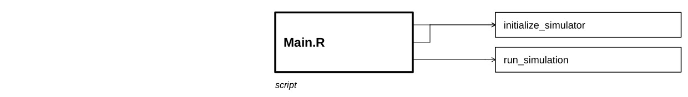

# Code structure

This page explains how the simulation code is laid out, how one piece of code calls the next, and where to read the detail of each piece.

Every piece of code that `Main.R` reaches, directly or through another piece, has its own page under [99_Readme/code](code/). There are 246 of them.

## How the code is organised

The simulation lives under `30_Simulation/`. The code of the system, which serves every asset, and the code of each type of model have folders of their own:

- `30_Simulation/Main.R` is the entry point. It is the only file meant to be run directly.
- `30_Simulation/04_Scripts/` holds the scripts of the system. A script is sourced, runs top to bottom and leaves its results in the calling environment. There are 11 of them.
- `30_Simulation/03_Functions/` holds the functions of the system. A function is called with arguments and returns a value. There are 140 of them.
- `30_Simulation/05_Models/<type>/` holds the code of one type of model, in three folders of the same names: `03_Functions/` for its functions, `04_Scripts/` for its scripts and `03_1_Functions_Cpp/` for its C++ code. The system calls the code of a type only through its contract. There are three types today: the building, in `30_Simulation/05_Models/01_Building/`, the photovoltaic installation, in `30_Simulation/05_Models/02_Photovoltaic/`, and the battery, in `30_Simulation/05_Models/03_Battery/`. Together they hold 78 functions, 3 scripts and 13 C++ files, one function each. The C++ files make two modules, one per type that has compiled code, and each module is compiled by a single `Rcpp::sourceCpp()` call on its `.cpp` file, with the headers it includes. The module of the building is the inner simulation loop, in `period_simulation_cpp.cpp`, and the electrical model of the heat pump that the simulation and the R functions share. The module of the battery, in `battery_trajectory_cpp.cpp`, is the physics of the energy it stores and the two searches of its flexibility windows: the factor of the battery and the correction of its Recovery Phase.

The other folders under `30_Simulation/` hold data (`01_Data/`), configuration (`02_Config/`) and results (`90_Output/`); they hold no code.

## The general flow

`Main.R` loads the simulator and calls `run_simulation()`, which does the whole simulation, one step after another, and writes the results. Read top to bottom, `run_simulation()` is the whole run. Its code is split into four blocks of numbered steps:

- **[A. Configuration and parameter loading](code/run_simulation__A.md)**
    - **1.** Check the arguments and set the paths &mdash; [apply_config_overrides.R](code/apply_config_overrides.md), [build_config_paths.R](code/build_config_paths.md)
    - **2.** Load data and model parameters &mdash; [load_all_parameters.R](code/load_all_parameters.md)
- **[B. Pre-processing](code/run_simulation__B.md)**
    - [B.1. Random seed](code/run_simulation__B_1.md)
        - **3.** Fix the random seed (reproducibility of the whole run) &mdash; inline code in run_simulation.R
    - [B.2. Climate and period](code/run_simulation__B_2.md)
        - **4.** Climate priority (before subsetting, needs full-year trailing averages) &mdash; [model_type_contract.R](code/model_type_contract.md)
        - **5.** Subset Main_df and the table of each asset by month / period &mdash; [subset_period.R](code/subset_period.md), [console_message.R](code/console_message.md)
    - [B.3. Profiles](code/run_simulation__B_3.md)
        - **6.** Profiles of each asset &mdash; [model_type_contract.R](code/model_type_contract.md), [console_message.R](code/console_message.md)
    - [B.4. Markets and prices](code/run_simulation__B_4.md)
        - **7.** Initialise market columns in Main_df, and the table of the &mdash; [prepare_market_calendar.R](code/prepare_market_calendar.md), [build_market_events.R](code/build_market_events.md)
        - **8.** Flexibility generation (conditional) &mdash; [prepare_flexibility_prices.R](code/prepare_flexibility_prices.md)
        - **9.** Energy/flexibility price signals (buy/sell derivation) &mdash; [prepare_energy_prices.R](code/prepare_energy_prices.md), [console_message.R](code/console_message.md)
        - **10.** Build future-horizon price matrices &mdash; [prepare_market_information.R](code/prepare_market_information.md)
        - **11.** Initialise market output matrices (market commitments) &mdash; [prepare_commitments.R](code/prepare_commitments.md)
        - **12.** Initialise the economic analysis accumulators &mdash; [prepare_economic_analysis.R](code/prepare_economic_analysis.md)
- **[C. Simulation](code/run_simulation__C.md)**
    - **13.** Perform simulation &mdash; [simulate.R](code/simulate.md)
- **[D. Post-process & Export](code/run_simulation__D.md)**
    - **14.** Complete the economic analysis (execution phase and fractions) &mdash; [finalize.R](code/finalize.md)
    - **15.** Export results to files &mdash; [write_outputs.R](code/write_outputs.md)
    - **16.** Return the results &mdash; inline code in run_simulation.R

The detail of the entry point itself is in [Main.R](code/Main.md).

## How these pages are made

These pages are generated from the code, not written by hand. The call lists are read from the code itself, and the rest is taken from each file's own header, so a page cannot drift from what its code does.

That also means an edit made here is lost the next time they are generated. To change a page, change the header of the code it documents, and generate the pages again.

## How to read a page

Every page follows the same shape:

- **Function** — what the piece does, as the file describes it in its own header.
- **Called by** — the pieces that call this one. The entry point is the only page with nothing here.
- **What it calls, in order of appearance** — the pieces this one calls, in the order they appear in the code. When a piece is called from several places, the number of call sites is given.
- **Input data** and **Output data** — the inputs and outputs declared in the file header.
- **Other notes** — anything else the header carries: the code outline, usage, exceptions, sign conventions.
- **Diagram** — a block diagram, described below.

A piece that calls more than six others is split into blocks, so that no single page has to be read against a long list. `simulate()` is the exception: its loop is documented on one page and one diagram. The blocks are listed on the piece's own page.

## How to read a diagram

Each page carries a block diagram in black and white:

- The **centre** block is the piece the page documents.
- On the **right** are the pieces it calls, top to bottom in the order they are called. Each call leaves the centre block at its own height, so a piece called several times is reached by several lines while its block is drawn once. Inside a loop (`for`, `while`, `repeat`) a piece is drawn with one line only, however many times the loop body calls it.
- On the **left** are the pieces that call it.

A piece that is split into blocks is drawn against its blocks, not against every item it calls; each block has its own page and diagram. The same holds for the pieces whose code is written in lettered blocks, such as `run_simulation()` and `load_all_parameters()`: their diagram shows their blocks, and a block that is split again shows its parts.

The labels leave out the folder of each piece: every script sits in a `04_Scripts/` folder and every function in a `03_Functions/` folder, of the system or of a type of model.

Each diagram is stored twice, as a `.jpg` that the page embeds and as a `.svg` for printing or editing. Both are A4 width.

## Index

### Entry point

- [Main.R](code/Main.md)

### Scripts

- [assemble_main_df.R](code/assemble_main_df.md)
- [load_03_market_config.R](code/load_03_market_config.md)
- [load_03_physical_properties.R](code/load_03_physical_properties.md)
- [load_04_market_config_scheduling.R](code/load_04_market_config_scheduling.md)
- [load_05_market_config_piloting.R](code/load_05_market_config_piloting.md)
- [load_11_model_parameters.R](code/load_11_model_parameters.md)
- [load_12_asset_registry.R](code/load_12_asset_registry.md)
- [load_13_modes_setpoints.R](code/load_13_modes_setpoints.md)
- [load_14_use_patterns.R](code/load_14_use_patterns.md)
- [load_16_debug_and_config.R](code/load_16_debug_and_config.md)
- [load_configuration_files.R](code/load_configuration_files.md)
- [load_energy_prices_df.R](code/load_energy_prices_df.md)
- [load_internal_parameters.R](code/load_internal_parameters.md)
- [load_meteo_df.R](code/load_meteo_df.md)

### Functions

- [accumulate_market_operation.R](code/accumulate_market_operation.md)
- [add_to_table_cells.R](code/add_to_table_cells.md)
- [aggregate_by_market_slot.R](code/aggregate_by_market_slot.md)
- [allocate_flex_events_per_day.R](code/allocate_flex_events_per_day.md)
- [apply_commitment_margin.R](code/apply_commitment_margin.md)
- [apply_config_overrides.R](code/apply_config_overrides.md)
- [apply_revenue_discount.R](code/apply_revenue_discount.md)
- [apply_table_writes.R](code/apply_table_writes.md)
- [asset_simulation_order.R](code/asset_simulation_order.md)
- [battery_continue_window_tail.R](code/battery_continue_window_tail.md)
- [battery_draw_leg.R](code/battery_draw_leg.md)
- [battery_execute_step.R](code/battery_execute_step.md)
- [battery_factor_search.R](code/battery_factor_search.md)
- [battery_free_trajectory.R](code/battery_free_trajectory.md)
- [battery_hold_room.R](code/battery_hold_room.md)
- [battery_initial_state.R](code/battery_initial_state.md)
- [battery_margin_fit.R](code/battery_margin_fit.md)
- [battery_mode_request.R](code/battery_mode_request.md)
- [battery_model_contract.R](code/battery_model_contract.md)
- [battery_modes.R](code/battery_modes.md)
- [battery_new_table.R](code/battery_new_table.md)
- [battery_plan_start_state.R](code/battery_plan_start_state.md)
- [battery_recovery_correction.R](code/battery_recovery_correction.md)
- [battery_simulate_itinerary.R](code/battery_simulate_itinerary.md)
- [battery_slot_offer.R](code/battery_slot_offer.md)
- [battery_stored_energy_change.R](code/battery_stored_energy_change.md)
- [battery_tail_state.R](code/battery_tail_state.md)
- [battery_trajectory.R](code/battery_trajectory.md)
- [battery_variable_registry.R](code/battery_variable_registry.md)
- [battery_window_contribution.R](code/battery_window_contribution.md)
- [battery_window_draft.R](code/battery_window_draft.md)
- [battery_window_feasible.R](code/battery_window_feasible.md)
- [battery_window_hold.R](code/battery_window_hold.md)
- [build_asset_paths.R](code/build_asset_paths.md)
- [build_config_paths.R](code/build_config_paths.md)
- [build_hvac_lock_caps.R](code/build_hvac_lock_caps.md)
- [build_market_events.R](code/build_market_events.md)
- [build_market_piece.R](code/build_market_piece.md)
- [build_market_timeline.R](code/build_market_timeline.md)
- [build_recovery_valuation.R](code/build_recovery_valuation.md)
- [build_reward_cache.R](code/build_reward_cache.md)
- [building_can_hold.R](code/building_can_hold.md)
- [building_gene_options.R](code/building_gene_options.md)
- [building_hold_room.R](code/building_hold_room.md)
- [building_initial_state.R](code/building_initial_state.md)
- [building_margin_data.R](code/building_margin_data.md)
- [building_margin_energy.R](code/building_margin_energy.md)
- [building_model_contract.R](code/building_model_contract.md)
- [building_new_table.R](code/building_new_table.md)
- [building_plan_start_state.R](code/building_plan_start_state.md)
- [building_prepare_period.R](code/building_prepare_period.md)
- [building_restate_systems.R](code/building_restate_systems.md)
- [building_slot_offer.R](code/building_slot_offer.md)
- [building_tail_state.R](code/building_tail_state.md)
- [building_variable_registry.R](code/building_variable_registry.md)
- [calc_differential_cost.R](code/calc_differential_cost.md)
- [check_recovery_convergence.R](code/check_recovery_convergence.md)
- [choose_recovery.R](code/choose_recovery.md)
- [chromosome_layout.R](code/chromosome_layout.md)
- [comfort_term.R](code/comfort_term.md)
- [commitment_margin_bound.R](code/commitment_margin_bound.md)
- [committed_recovery_cost.R](code/committed_recovery_cost.md)
- [compute_Rvent.R](code/compute_Rvent.md)
- [compute_available_segments.R](code/compute_available_segments.md)
- [compute_marginal_distribution_cost.R](code/compute_marginal_distribution_cost.md)
- [compute_marginal_energy_cost.R](code/compute_marginal_energy_cost.md)
- [compute_marginal_flex_revenue.R](code/compute_marginal_flex_revenue.md)
- [compute_max_steps_ahead.R](code/compute_max_steps_ahead.md)
- [compute_recovery_energy_cost.R](code/compute_recovery_energy_cost.md)
- [compute_stored_energy_value.R](code/compute_stored_energy_value.md)
- [console_duration.R](code/console_duration.md)
- [console_message.R](code/console_message.md)
- [console_time.R](code/console_time.md)
- [context_forecast_step.R](code/context_forecast_step.md)
- [continue_standing_tail.R](code/continue_standing_tail.md)
- [convert_modes_to_setpoints.R](code/convert_modes_to_setpoints.md)
- [copy_asset_inputs.R](code/copy_asset_inputs.md)
- [decode_battery_genes.R](code/decode_battery_genes.md)
- [decode_building_genes.R](code/decode_building_genes.md)
- [decode_chromosome.R](code/decode_chromosome.md)
- [derive_flex_itineraries.R](code/derive_flex_itineraries.md)
- [drop_unit_row.R](code/drop_unit_row.md)
- [economic_terms.R](code/economic_terms.md)
- [estimate_price_signal.R](code/estimate_price_signal.md)
- [evaluate_control.R](code/evaluate_control.md)
- [finalize.R](code/finalize.md)
- [first_by_slot.R](code/first_by_slot.md)
- [fitness_funct_optimize_mode.R](code/fitness_funct_optimize_mode.md)
- [flex_commitment_profile.R](code/flex_commitment_profile.md)
- [flex_evaluation.R](code/flex_evaluation.md)
- [flex_leg_reward_terms.R](code/flex_leg_reward_terms.md)
- [flex_margined_profile.R](code/flex_margined_profile.md)
- [flex_refused.R](code/flex_refused.md)
- [flex_up_power_limit.R](code/flex_up_power_limit.md)
- [flex_window_draft.R](code/flex_window_draft.md)
- [flex_window_is_feasible.R](code/flex_window_is_feasible.md)
- [ga_crossover_int.R](code/ga_crossover_int.md)
- [ga_mutation_int.R](code/ga_mutation_int.md)
- [ga_population_int.R](code/ga_population_int.md)
- [generate_flexibility_actions_df.R](code/generate_flexibility_actions_df.md)
- [generate_flexibility_events.R](code/generate_flexibility_events.md)
- [generate_meteo_transformations_df.R](code/generate_meteo_transformations_df.md)
- [generate_variables_df.R](code/generate_variables_df.md)
- [get_validation_bounds.R](code/get_validation_bounds.md)
- [hand_over_window_tail.R](code/hand_over_window_tail.md)
- [heat_pump_cop.R](code/heat_pump_cop.md)
- [heat_pump_electricity.R](code/heat_pump_electricity.md)
- [hold_standing_window.R](code/hold_standing_window.md)
- [imperfect_forecast.R](code/imperfect_forecast.md)
- [implement_control_step.R](code/implement_control_step.md)
- [initialization.R](code/initialization.md)
- [initialize_simulator.R](code/initialize_simulator.md)
- [instant_market_slot.R](code/instant_market_slot.md)
- [is_market_active.R](code/is_market_active.md)
- [itinerary_columns.R](code/itinerary_columns.md)
- [join_asset_tables.R](code/join_asset_tables.md)
- [joined_column_order.R](code/joined_column_order.md)
- [load_all_parameters.R](code/load_all_parameters.md)
- [load_battery_parameters.R](code/load_battery_parameters.md)
- [load_building_parameters.R](code/load_building_parameters.md)
- [load_market_config_table.R](code/load_market_config_table.md)
- [load_needed_columns.R](code/load_needed_columns.md)
- [load_parameter_block.R](code/load_parameter_block.md)
- [load_parameter_catalogue.R](code/load_parameter_catalogue.md)
- [load_parameter_file.R](code/load_parameter_file.md)
- [load_photovoltaic_parameters.R](code/load_photovoltaic_parameters.md)
- [lowest_mode_setpoints.R](code/lowest_mode_setpoints.md)
- [map_optimization_aim.R](code/map_optimization_aim.md)
- [market_event_index.R](code/market_event_index.md)
- [market_slot_index.R](code/market_slot_index.md)
- [maxmode.R](code/maxmode.md)
- [model_type_contract.R](code/model_type_contract.md)
- [optimize_control_step.R](code/optimize_control_step.md)
- [optimize_modes.R](code/optimize_modes.md)
- [period_calculation.R](code/period_calculation.md)
- [photovoltaic_execute_step.R](code/photovoltaic_execute_step.md)
- [photovoltaic_generation.R](code/photovoltaic_generation.md)
- [photovoltaic_model_contract.R](code/photovoltaic_model_contract.md)
- [photovoltaic_new_table.R](code/photovoltaic_new_table.md)
- [photovoltaic_solar_geometry.R](code/photovoltaic_solar_geometry.md)
- [photovoltaic_variable_registry.R](code/photovoltaic_variable_registry.md)
- [piece_absorb_asset.R](code/piece_absorb_asset.md)
- [piece_asset_layout.R](code/piece_asset_layout.md)
- [piece_asset_view.R](code/piece_asset_view.md)
- [piece_layout.R](code/piece_layout.md)
- [piece_rows.R](code/piece_rows.md)
- [piece_working_columns.R](code/piece_working_columns.md)
- [piece_write_rows.R](code/piece_write_rows.md)
- [place_flex_candidate.R](code/place_flex_candidate.md)
- [plane_of_array_irradiance.R](code/plane_of_array_irradiance.md)
- [pre_horizon_window_tails.R](code/pre_horizon_window_tails.md)
- [prepare_climate.R](code/prepare_climate.md)
- [prepare_comfort_bands.R](code/prepare_comfort_bands.md)
- [prepare_commitments.R](code/prepare_commitments.md)
- [prepare_economic_analysis.R](code/prepare_economic_analysis.md)
- [prepare_energy_prices.R](code/prepare_energy_prices.md)
- [prepare_flexibility_prices.R](code/prepare_flexibility_prices.md)
- [prepare_market_calendar.R](code/prepare_market_calendar.md)
- [prepare_market_information.R](code/prepare_market_information.md)
- [prepare_occupancy.R](code/prepare_occupancy.md)
- [prepare_scheduling.R](code/prepare_scheduling.md)
- [price_estimate_sources.R](code/price_estimate_sources.md)
- [price_variation_at_lead.R](code/price_variation_at_lead.md)
- [propagate_differential_cost.R](code/propagate_differential_cost.md)
- [propagate_unit_value.R](code/propagate_unit_value.md)
- [read_and_validate_parameter_csv.R](code/read_and_validate_parameter_csv.md)
- [read_file_paths_table.R](code/read_file_paths_table.md)
- [reconstruct_flex_phases.R](code/reconstruct_flex_phases.md)
- [reset_index_list.R](code/reset_index_list.md)
- [resolve_config_key.R](code/resolve_config_key.md)
- [resolve_flex_down_hvac.R](code/resolve_flex_down_hvac.md)
- [resolve_flex_up_hvac.R](code/resolve_flex_up_hvac.md)
- [resolve_marginal_context.R](code/resolve_marginal_context.md)
- [resolve_market_index.R](code/resolve_market_index.md)
- [revenue_discount_factor.R](code/revenue_discount_factor.md)
- [reward_function.R](code/reward_function.md)
- [run_market_process.R](code/run_market_process.md)
- [run_market_role.R](code/run_market_role.md)
- [run_simulation.R](code/run_simulation.md)
- [safe_fraction.R](code/safe_fraction.md)
- [settle_execution.R](code/settle_execution.md)
- [settle_market.R](code/settle_market.md)
- [simulate.R](code/simulate.md)
- [solar_position.R](code/solar_position.md)
- [split_config_sections.R](code/split_config_sections.md)
- [split_market_operation.R](code/split_market_operation.md)
- [start_worker_cluster.R](code/start_worker_cluster.md)
- [subset_period.R](code/subset_period.md)
- [sum_asset_energy.R](code/sum_asset_energy.md)
- [sum_by_slot.R](code/sum_by_slot.md)
- [system_commitment_margin.R](code/system_commitment_margin.md)
- [system_energy_rows.R](code/system_energy_rows.md)
- [system_flex_commitment.R](code/system_flex_commitment.md)
- [system_flex_frame.R](code/system_flex_frame.md)
- [system_flex_window.R](code/system_flex_window.md)
- [system_hold_window.R](code/system_hold_window.md)
- [system_net_energy.R](code/system_net_energy.md)
- [system_net_energy_column.R](code/system_net_energy_column.md)
- [system_net_energy_columns.R](code/system_net_energy_columns.md)
- [system_stored_energy.R](code/system_stored_energy.md)
- [to_local_indexes.R](code/to_local_indexes.md)
- [try_flex_echo.R](code/try_flex_echo.md)
- [type_parameter_values.R](code/type_parameter_values.md)
- [validate_Main_df.R](code/validate_Main_df.md)
- [validate_asset_df.R](code/validate_asset_df.md)
- [validate_dataframe_config.R](code/validate_dataframe_config.md)
- [validate_market_coverage.R](code/validate_market_coverage.md)
- [validate_model_parameters.R](code/validate_model_parameters.md)
- [validate_parameter_config.R](code/validate_parameter_config.md)
- [validate_parameter_relations.R](code/validate_parameter_relations.md)
- [validate_physical_properties.R](code/validate_physical_properties.md)
- [validate_time_grid.R](code/validate_time_grid.md)
- [value_flex_operation.R](code/value_flex_operation.md)
- [variable_registry_columns.R](code/variable_registry_columns.md)
- [write_asset_template.R](code/write_asset_template.md)
- [write_itineraries.R](code/write_itineraries.md)
- [write_outputs.R](code/write_outputs.md)
- [write_rest_net.R](code/write_rest_net.md)

### C++ modules

- [apply_commitment_margin_cpp.h](code/apply_commitment_margin_cpp.md)
- [battery_factor_search_cpp.h](code/battery_factor_search_cpp.md)
- [battery_free_run.h](code/battery_free_run.md)
- [battery_free_trajectory_cpp.h](code/battery_free_trajectory_cpp.md)
- [battery_limits.h](code/battery_limits.md)
- [battery_recovery_correction_core.h](code/battery_recovery_correction_core.md)
- [battery_recovery_correction_cpp.h](code/battery_recovery_correction_cpp.md)
- [battery_step_terms.h](code/battery_step_terms.md)
- [battery_trajectory_cpp.cpp](code/battery_trajectory_cpp.md)
- [heat_pump_cop_cpp.h](code/heat_pump_cop_cpp.md)
- [heat_pump_electricity_cpp.h](code/heat_pump_electricity_cpp.md)
- [heat_pump_electricity_step.h](code/heat_pump_electricity_step.md)
- [period_simulation_cpp.cpp](code/period_simulation_cpp.md)

---

[Back to the main README](../README.md)
