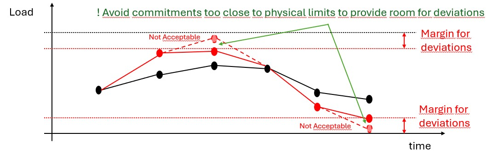
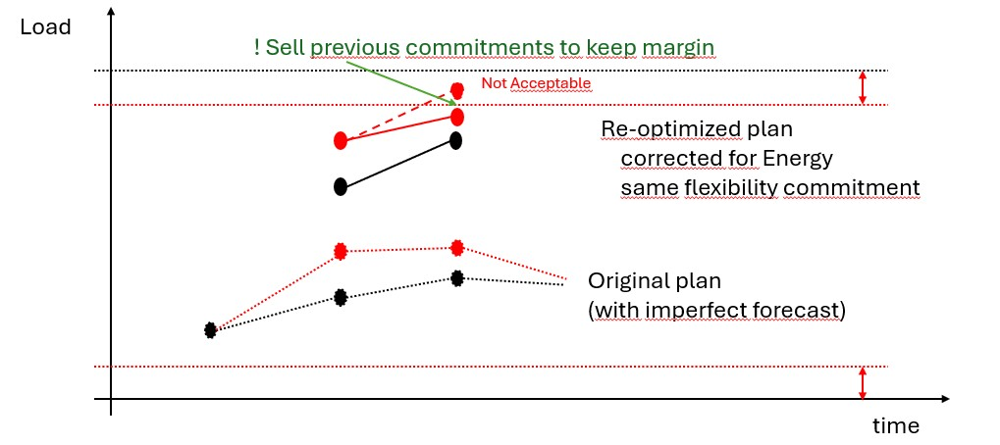

# Flexibility, Revenues and Events

Real-life markets provide incentives (revenues) for stakeholders to support grid stability. These consist on separate payments for commitments to flexibilize loads (either/both upwards and downwards), and for the execution of these commitments upon short-notice orders by the grid operator.

Flexibility bids and commitments operate in a similar way to energy trading. Except that in this case, the commitment is not the consumption/injection of energy, but the willingness to adapt load profiles as requested by the grid operator. The same market horizons and resolutions apply.

## Certainty & Triple Path

Although the Energy market seeks certainty in energy delivery, the Flexibility market seeks adaptability to unexpected deviations/events. Accordingly, the load profile of a builiding is no longer certain, and it can deviate anyway in the folllowing range.

Final Load (t) is within Base Load (t) - Downward Flexibility Commitment (t) and Base Load (t) + Upward Flexibility Commitment (t)

Accordingly, there is a need to ensure that the building remains within comfort levels whichever the Final Load (t) is.

To do so, a **triple path approach** is performed in the assessment. The performance of the building shall satisfy comfort conditions for the following three paths:

- Base load, without activation of the flexibility requests (`plan`)

- Downward flexibilized load, with full activation of the downward flexibility commitments (`plan_flex_down`)

- Upward flexibilized load, with full activation of the upward flexibility commitments (`plan_flex_up`)

The comfort penalty applies whenever any of the three paths is out of its comfort band. Inside a flexibility window, from the Commitment Phase to the end of the Recovery Phase, the flexibility paths are measured against the occupancy band, which is wider than the planning band before occupancy. Any real situation is expected to lie somewhere in between these cases. With either shorter-timespan, or partial-load activation of the flexibility commitment.

## Flexibility Events & Model in this repository

The flexibility market is equal to the energy market in terms of market horizon and resolution, but the activation of flexibility commitments are not expected to be continuous. Activation will be discontinuous and partial, linked to the operational needs of the energy grid.

To define this, a model was defined in `09_flexibility_price_emulation.R`. This model creates fictive flexibility events, where the price of flexibility commitments and commitment execution, as well as the execution probability, are defined. Two modes exist, controlled by `Complex_Market_Config` in `03_Market_config.csv`:

- **Basic** (`Complex_Market_Config == "no"`): a maximum number of events per day, their maximum commitment/execution price, maximum event length and maximum activation likelihood are defined (`03_Market_config.csv`). For each day in the simulation, the actual number of events, prices, event lengths and likelihood are obtained based on random numbers, and each event is placed at a random slot-aligned position within the day.

- **Market-aware** (`Complex_Market_Config == "yes"`): events generated in intra-day are linked. See [Market-aware flexibility generation in detail](#market-aware-flexibility-generation-in-detail) below.

Altogether this provides an economic context for the simulations to be performed.

### The three phases of an event

An **Event** is the whole flexibility window, and it is made of three phases. `Flex_phase_down_plan`/`Flex_phase_up_plan` record which phase each row belongs to:

1. **Commitment Phase.** The period in which flexibility is committed. It is the only phase that carries an economic commitment: `reward_function()` bounds the energy difference to it, so the rebound of the phases that follow is not valued as flexibility of the opposite sign.
2. **Neutral Phase.** The period in which the flexibility itinerary is locked so that its energy consumption is identical to that of the itinerary of origin, the one without flexibility. The power of every step is imposed from the plan, so the two itineraries spend exactly the same.
3. **Recovery Phase.** The period in which the consumption may be modified to bring the flexibility itinerary back to the itinerary of origin. The thermostat decides again, but only within a restriction: the system that was **not** used to provide the flexibility service may hold or reduce its power, never increase it. The system that did provide the service may vary freely.

### The system lock

The restriction of the Recovery Phase is imposed step by step, through `calculation_mode 3` of `period_simulation_cpp.cpp`, with the per-step caps that `build_system_lock_caps()` builds from the `_plan` itinerary. Bounding each step before the RC equations, rather than trimming a finished trajectory, is what makes the resulting trajectory physical: the cap of one step propagates to the state the next step's thermostat decides on.

The restriction corresponds to an interpretation of the legal regulation of HVAC systems, which does not allow energy management through the alternating use of heating and cooling. A building may not, for instance, offset an upward heating event by cooling itself down afterwards.

## Market-aware flexibility generation in detail

Flexibility events are processed in cascade in`generate_flexibility_events.R` as follows:

- Initially, events are defined in scheduling markets.

- As there might be several scheduling markets operationg over the same time span. Any new scheduling market checks for pre-existing events, and defines an exclusion zone of 3h around previously defined events. And then generates new events in the remaining area.

- Additionally, existing events may be slightly shifted (anticipated or delayed) in scheduling markets.

- During piloting, new flexibility events are randomly generated. These are assumed to arise either from unanticipated grid stability needs, or from balancing markets. These events are more frequent in the short-term. 

### Scheduling

A Scheduling market plans flexibility events well ahead of time, the same way a day-ahead or intraday energy market plans purchases well before delivery. Each Scheduling market covers a fixed period of time, called its horizon (for example, the next 24 hours). Its goal is to decide, in advance, when the building could offer flexibility during that horizon.

For a specific day, the very first Scheduling market does not have any pre-existing definition: no flexibility events exist yet anywhere in the simulation. In this case, the market simply creates a small number of new candidate events (up to a configured maximum per day) at random positions inside its own horizon. Each candidate gets a random start time, a random duration, and its own commitment price, execution price, and probability of being activated.

Every later Scheduling market does not start blank. By the time it runs, earlier Scheduling markets may already have placed events, and some of those events may fall close to, or inside, this new market's horizon.

Every existing event keeps a 3-hour exclusion zone before and after it - a period of time reserved just for that event. This exists because after the building offers flexibility once, it needs time to recover before it can safely offer flexibility again. A new event can never be placed inside another event's exclusion zone.

So, before placing any new candidate, a new Scheduling market first checks whether any existing event's exclusion zone reaches into its own horizon.

For each pre-existing event, there is a possbility to slightly displace the event. This is only allowed once: a random draw decides whether the event should try to move earlier, move later, or not move at all. If a move is attempted, the event shifts by a random amount (up to a configured maximum hours), but only if the new position does not land inside any other event's exclusion zone. If it does not fit, the event simply stays exactly where it was. Either way, this is that event's only chance to move - no later market will ever offer it another one.

Only after this step does the market place its own new candidate events - and only in whatever parts of its horizon are still free of every event's exclusion zone.

### Piloting

A Piloting market reacts much closer to real time than a Scheduling market. Its goal is to represent flexibility that becomes available on short notice - for example, because the grid needs help right now, or because a short-term balancing market has just opened close to the delivery time.

A Piloting market places its candidate events the same simple way a blank-slate Scheduling market does: it draws a small number of new candidate events (up to a configured maximum per day), each with a random start time and duration inside the market's own horizon.

Unlike Scheduling, a Piloting market never checks for an exclusion zone, and never tries to move any existing event out of the way. A Piloting candidate can be placed at any time inside its horizon, even if that time is already used by a Scheduling event.

Instead, every Piloting candidate goes through a different check: the closer the start time is to the moment the market opened (its `Bid_time`), the more likely it is for a flexibility event to occur. The further into the future , the less likely it is to occur. This is meant to represent how, in a real short-term market, deviations are more frequent in the short-term.

If a Piloting event ends up covering the same time as an existing Scheduling event, the Piloting event replaces it there. This is because every Piloting market is processed only after all Scheduling markets are done, and it represents the most up-to-date decision for that moment in time.

## Windows that started before the optimization horizon

A market is called at `i0` and optimizes from `i_begin_horizon`. Between the two, the building follows the plan it already has, including any flexibility window committed by an earlier market whose Commitment Phase starts there. Such a window may run its Neutral and Recovery Phases into the horizon of the market being optimized.

The market therefore extends that simulated stretch to the end of the last of those Recovery Phases and rebuilds the window whole, over the plan the earlier markets left there. During the optimization, the tail of the window is held as it was rebuilt, and no new window of the same leg may start until its Recovery Phase is over. The same rule keeps new windows off any window already committed inside the horizon, counting its Neutral and Recovery Phases. Windows of different legs may still overlap.

## Projection and guard zone of a standing commitment

Every market restates over its new plan the flexibility already committed by earlier markets. How a row of a Commitment Phase is restated depends on where it falls, and not on the aim of the market:

- **Projection**, outside the market interval: between `i0` and `i_begin_horizon`, and after `i_end_control`. This market does not trade those rows. The window is drawn as the new plan allows, without `flexibility_commitment_margin` and without judging whether it can be delivered, and the commitment sold there is not changed. Later markets, or the execution, deal with any shortfall.
- **Guard zone**, inside the market interval, from `i_begin_horizon` to `i_end_control`. The window keeps `flexibility_commitment_margin`. When the new plan can no longer hold what was sold with that margin, the window is restated at the most the margin allows, and the difference is bought back.

A window whose Commitment Phase crosses `i_begin_horizon` or `i_end_control` is split: each part follows its own rule.

The guard zone applies to every aim. For a market with the Operation aim it is the only flexibility it trades: it places no new window and does not re-optimize commitments. Any other flexibility operation needs the Operation+Flexibility aim.

A window of the guard zone that would raise both thermal systems over the new plan cannot be drawn. It is then held as it stands, nothing is bought back, and the market issues a warning.

## Revenues

Within the decision-making process, and the reward formulae, Economic balances with the network are assessed as follows:

- Cost/Revenue of Energy Flow is considered with 100% certainty

- Revenues for flexibility commitments are considered with 100% certainty

- Revenues associated for the execution of flexibility commitments are considered with the likelyhood defined in the section above

The market is firm, which is why energy flows and flexibility commitments are considered with 100% certainty. Income is nevertheless discounted with `Revenue_discount_per_hour` (see the Policy section of the main README), to account for the uncertainty of the predictions the decision relies on: if a prediction turns out wrong, later markets re-adjust the position. Expense is not discounted.

## Locking for un-desire behavior

Thermal systems with dual heating and cooling services are particularly complex for optimization. Particularly in the context of load optimization (i.e. with negative prices or high pricing for flexibilization). This may result in a system "overheating" and a later "downcooling". While economically "optimal" this is a waste of energy.

To avoid this behavior, a set of surveilance methods are defined.

- Upward flexibility is only offered by the system the building is clearly using. From the start of a candidate window, the planned electricity of each system is added up over a short horizon (`flex_up_horizon_short`) and a mid horizon (`flex_up_horizon_long`). In each horizon, a system dominates when the difference between the two totals, divided by the larger one, exceeds `flex_up_dominance_threshold` (%). If the same system dominates both horizons, only that system may be raised for the window, and the other one is switched off; otherwise no upward flexibility is offered from that start. Because a single system is raised, the window cannot alternate heating and cooling.

- Additionally, a window is refused when, over its three phases, the electricity of BOTH systems rises above the plan by more than a tolerance: the larger of `flex_feasibility_tolerance` (%) of the larger rise and `flex_feasibility_floor` (kWh). One system rising while the other falls is allowed.

Additionally, imperfect forecasts can result in system paths deviating from the plan, potentially resulting in non-executable flexibility commitments. To avoid this, safety margins are imposed to all flexibility commitmetms:

- `flexibility_commitment_margin` (kW): headroom kept in every market slot of a window, so a later re-optimization can still adjust without breaking what was sold. Downward, electricity stays at least this far above zero; upward, at least this far below the system's ceiling. The same margin is the guard zone of a standing commitment inside the market interval; a projected window does not keep it (see [Projection and guard zone of a standing commitment](#projection-and-guard-zone-of-a-standing-commitment)).

- `flex_restatement_tol` (kWh): when a later market re-optimizes, the commitment already sold is rebuilt over the new plan. It may fall short of its target by this much at most. If it falls further short inside the market interval, the market buys back the part it can no longer hold, whatever its aim.

This can be seen in the following figures.

**Flexibility limitations in first optimization (`flexibility_commitment_margin`):**

**Flexibility limitations in re-optimization process (`flex_restatement_tol`):**

------------------------------------------------------------------------

[Back to README](../README.md)
