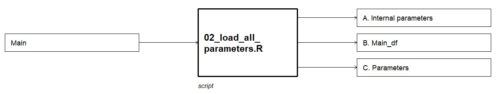

# 02_load_all_parameters.R

**Script** &nbsp;·&nbsp; `30_Simulation/04_Scripts/02_load_all_parameters.R`

## Function

Master parameter-loading script. Replaces data_model_parameters.R, control_optimization_parameters.R, and market_config_parameters.R. Executes one sub-script per configuration file, each of which validates the loaded values against Parameter_config.csv.

## Called by

- [Main.R](Main.md)

## What it calls, in order of appearance

- [load_01_computing_parameters.R](load_01_computing_parameters.md)
- [load_03_physical_properties.R](load_03_physical_properties.md)
- [load_16_debug_and_config.R](load_16_debug_and_config.md)
- [assemble_main_df.R](assemble_main_df.md)
- [validate_Main_df.R](validate_Main_df.md)
- [load_01_optimization_parameters.R](load_01_optimization_parameters.md)
- [load_02_control.R](load_02_control.md)
- [load_03_market_config.R](load_03_market_config.md)
- [load_04_market_config_scheduling.R](load_04_market_config_scheduling.md)
- [load_05_market_config_piloting.R](load_05_market_config_piloting.md)
- [load_06_energy_price_parameters.R](load_06_energy_price_parameters.md)
- [load_07_flexibility_price_emulation.R](load_07_flexibility_price_emulation.md)
- [load_08_flexibility_event_configuration.R](load_08_flexibility_event_configuration.md)
- [load_09_reward_parameters.R](load_09_reward_parameters.md)
- [load_10_operational_temperature_corrections.R](load_10_operational_temperature_corrections.md)
- [load_11_model_parameters.R](load_11_model_parameters.md)
- [load_12_temperature_setpoints.R](load_12_temperature_setpoints.md)
- [load_13_modes_setpoints.R](load_13_modes_setpoints.md)
- [load_14_use_patterns.R](load_14_use_patterns.md)
- [load_15_forecast_parameters.R](load_15_forecast_parameters.md)

## Blocks

The code of 02_load_all_parameters.R is split into 3 blocks, each made of numbered steps. A block that calls more than six items is split again into consecutive steps.

- [A. Internal parameters](02_load_all_parameters__A.md) &nbsp;(steps 1 to 5)
- [B. Main_df](02_load_all_parameters__B.md) &nbsp;(steps 6 to 7)
- [C. Parameters](02_load_all_parameters__C.md) &nbsp;(steps 8 to 23)
    - [C.1. Steps 8 to 13](02_load_all_parameters__C_1.md)
    - [C.2. Steps 14 to 19](02_load_all_parameters__C_2.md)
    - [C.3. Steps 20 to 23](02_load_all_parameters__C_3.md)

## Input data

- paths List. Paths set by 01_initialization.R.

## Output data

- Main_df    : Data frame. Main simulation data frame (full year, not subsetted).
- parameters : List with these sub-lists:
    - computing
    - physical_properties
    - needed_cols
    - model
    - use_patterns
    - control
    - setpoint_modes
    - optimization
    - market
    - market_config_scheduling
    - market_config_piloting
    - reward
    - operational_temperature_corrections
    - forecast
    - energy_price
    - flexibility_price_emulation
    - debug_and_config

## Other notes from the file header

### Code outline

A. Internal parameters

1. Validation configuration files (Parameter_config.csv and the validation tables of 00_Validation/)
2. Computing parameters, which the assembly of Main_df needs
3. Physical properties
4. Debug and configuration
5. Needed columns

B. Main_df

6. Assemble Main_df via assemble_main_df.R (Meteo_df/ Energy_Prices_df + synthetic dataframes), force Occupancy/Scheduling to 0
7. Validate its structure (validate_Main_df())

C. Parameters

- 8-22. One loader per configuration file, from 01_Optimization_parameters.csv to 15_Forecast_parameters.csv
23. Recalculate T_ext_24h from previous-day averages

### Usage instructions

```r
source(file.path("30_Simulation", "04_Scripts", "02_load_all_parameters.R"))
```

Not called: sourced by Main.R after 01_initialization.R, and it sources in turn every loader of 02_Config.

## Diagram



Also available as [02_load_all_parameters.svg](02_load_all_parameters.svg).

---

[Back to the code structure index](../Code_Structure.md)
