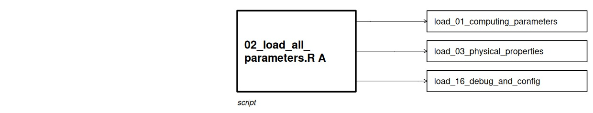

# 02_load_all_parameters.R &mdash; A. Internal parameters

Block A of [02_load_all_parameters.R](02_load_all_parameters.md), steps 1 to 5.

## Steps

- **1.** Validation configuration files &mdash; inline code in 02_load_all_parameters.R
- **2.** Computing parameters &mdash; [load_01_computing_parameters.R](load_01_computing_parameters.md)
- **3.** Physical properties &mdash; [load_03_physical_properties.R](load_03_physical_properties.md)
- **4.** Debug and configuration &mdash; [load_16_debug_and_config.R](load_16_debug_and_config.md)
- **5.** Needed columns &mdash; inline code in 02_load_all_parameters.R

## Diagram

Also available as [02_load_all_parameters__A.svg](02_load_all_parameters__A.svg).

---

[Back to 02_load_all_parameters.R](02_load_all_parameters.md) &nbsp;·&nbsp; [Back to the code structure index](../Code_Structure.md)
