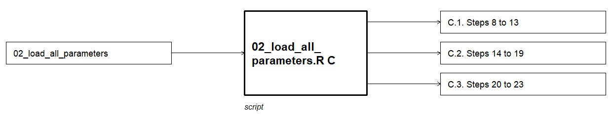

# 02_load_all_parameters.R &mdash; C. Parameters

Block C of [02_load_all_parameters.R](02_load_all_parameters.md), steps 8 to 23.

## Steps

- **8.** Optimization parameters &mdash; [load_01_optimization_parameters.R](load_01_optimization_parameters.md)
- **9.** Control &mdash; [load_02_control.R](load_02_control.md)
- **10.** Market configuration &mdash; [load_03_market_config.R](load_03_market_config.md)
- **11.** Market configuration, scheduling &mdash; [load_04_market_config_scheduling.R](load_04_market_config_scheduling.md)
- **12.** Market configuration, piloting &mdash; [load_05_market_config_piloting.R](load_05_market_config_piloting.md)
- **13.** Energy price parameters &mdash; [load_06_energy_price_parameters.R](load_06_energy_price_parameters.md)
- **14.** Flexibility price emulation &mdash; [load_07_flexibility_price_emulation.R](load_07_flexibility_price_emulation.md)
- **15.** Flexibility event configuration &mdash; [load_08_flexibility_event_configuration.R](load_08_flexibility_event_configuration.md)
- **16.** Reward parameters &mdash; [load_09_reward_parameters.R](load_09_reward_parameters.md)
- **17.** Operational temperature corrections &mdash; [load_10_operational_temperature_corrections.R](load_10_operational_temperature_corrections.md)
- **18.** Model parameters &mdash; [load_11_model_parameters.R](load_11_model_parameters.md)
- **19.** Temperature setpoints &mdash; [load_12_temperature_setpoints.R](load_12_temperature_setpoints.md)
- **20.** Modes setpoints &mdash; [load_13_modes_setpoints.R](load_13_modes_setpoints.md)
- **21.** Use patterns &mdash; [load_14_use_patterns.R](load_14_use_patterns.md)
- **22.** Forecast parameters &mdash; [load_15_forecast_parameters.R](load_15_forecast_parameters.md)
- **23.** Recalculate T_ext_24h &mdash; inline code in 02_load_all_parameters.R

## Parts

The block calls 15 items, so it is documented in parts:

- [C.1. Steps 8 to 13](02_load_all_parameters__C_1.md) &nbsp;(steps 8 to 13)
- [C.2. Steps 14 to 19](02_load_all_parameters__C_2.md) &nbsp;(steps 14 to 19)
- [C.3. Steps 20 to 23](02_load_all_parameters__C_3.md) &nbsp;(steps 20 to 23)

## Diagram

Also available as [02_load_all_parameters__C.svg](02_load_all_parameters__C.svg).

---

[Back to 02_load_all_parameters.R](02_load_all_parameters.md) &nbsp;·&nbsp; [Back to the code structure index](../Code_Structure.md)
