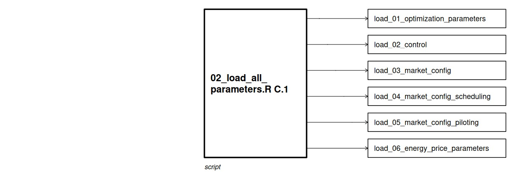

# 02_load_all_parameters.R &mdash; C.1. Steps 8 to 13

Part 1 of 3 of block [C. Parameters](02_load_all_parameters__C.md) of [02_load_all_parameters.R](02_load_all_parameters.md).

## Steps

- **8.** Optimization parameters &mdash; [load_01_optimization_parameters.R](load_01_optimization_parameters.md)
- **9.** Control &mdash; [load_02_control.R](load_02_control.md)
- **10.** Market configuration &mdash; [load_03_market_config.R](load_03_market_config.md)
- **11.** Market configuration, scheduling &mdash; [load_04_market_config_scheduling.R](load_04_market_config_scheduling.md)
- **12.** Market configuration, piloting &mdash; [load_05_market_config_piloting.R](load_05_market_config_piloting.md)
- **13.** Energy price parameters &mdash; [load_06_energy_price_parameters.R](load_06_energy_price_parameters.md)

## Diagram

Also available as [02_load_all_parameters__C_1.svg](02_load_all_parameters__C_1.svg).

---

[Back to block C](02_load_all_parameters__C.md) &nbsp;·&nbsp; [Back to 02_load_all_parameters.R](02_load_all_parameters.md) &nbsp;·&nbsp; [Back to the code structure index](../Code_Structure.md)
