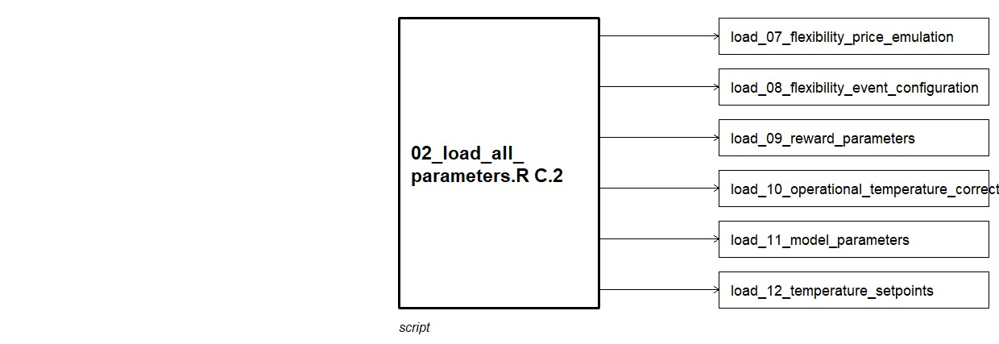

# 02_load_all_parameters.R &mdash; C.2. Steps 14 to 19

Part 2 of 3 of block [C. Parameters](02_load_all_parameters__C.md) of [02_load_all_parameters.R](02_load_all_parameters.md).

## Steps

- **14.** Flexibility price emulation &mdash; [load_07_flexibility_price_emulation.R](load_07_flexibility_price_emulation.md)
- **15.** Flexibility event configuration &mdash; [load_08_flexibility_event_configuration.R](load_08_flexibility_event_configuration.md)
- **16.** Reward parameters &mdash; [load_09_reward_parameters.R](load_09_reward_parameters.md)
- **17.** Operational temperature corrections &mdash; [load_10_operational_temperature_corrections.R](load_10_operational_temperature_corrections.md)
- **18.** Model parameters &mdash; [load_11_model_parameters.R](load_11_model_parameters.md)
- **19.** Temperature setpoints &mdash; [load_12_temperature_setpoints.R](load_12_temperature_setpoints.md)

## Diagram

Also available as [02_load_all_parameters__C_2.svg](02_load_all_parameters__C_2.svg).

---

[Back to block C](02_load_all_parameters__C.md) &nbsp;·&nbsp; [Back to 02_load_all_parameters.R](02_load_all_parameters.md) &nbsp;·&nbsp; [Back to the code structure index](../Code_Structure.md)
