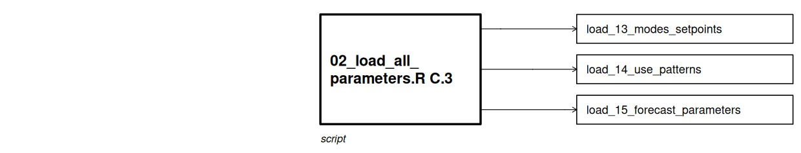

# 02_load_all_parameters.R &mdash; C.3. Steps 20 to 23

Part 3 of 3 of block [C. Parameters](02_load_all_parameters__C.md) of [02_load_all_parameters.R](02_load_all_parameters.md).

## Steps

- **20.** Modes setpoints &mdash; [load_13_modes_setpoints.R](load_13_modes_setpoints.md)
- **21.** Use patterns &mdash; [load_14_use_patterns.R](load_14_use_patterns.md)
- **22.** Forecast parameters &mdash; [load_15_forecast_parameters.R](load_15_forecast_parameters.md)
- **23.** Recalculate T_ext_24h &mdash; inline code in 02_load_all_parameters.R

## Diagram

Also available as [02_load_all_parameters__C_3.svg](02_load_all_parameters__C_3.svg).

---

[Back to block C](02_load_all_parameters__C.md) &nbsp;·&nbsp; [Back to 02_load_all_parameters.R](02_load_all_parameters.md) &nbsp;·&nbsp; [Back to the code structure index](../Code_Structure.md)
