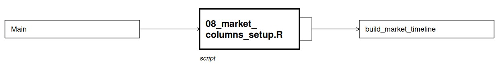

# 08_market_columns_setup.R

**Script** &nbsp;·&nbsp; `30_Simulation/04_Scripts/08_market_columns_setup.R`

## Function

Initialises and populates the Sched_* and Pilot_* market columns in Main_df using the already-loaded parameters:

- parameters$market
- parameters$market_config_scheduling
- parameters$market_config_piloting

Supports two modes:

- Basic  (Complex_Market_Config == "no") : deterministic market timeline from optimisation horizons.
- Complex (Complex_Market_Config == "yes") : timeline built from the market-config tables. In complex mode, the optimization horizon is computed from end_optimization.

Sourced from Main.R, after the month/period subset and before 09_flexibility_price_emulation.R (price emulation).

## Called by

- [Main.R](Main.md)

## What it calls, in order of appearance

- [build_market_timeline.R](build_market_timeline.md) &nbsp;(2 call sites)

## Input data

- Main_df, with its time and MarketUTC columns.
- parameters$market and the two market configuration tables, for Scheduling and for Piloting.

## Output data

- Main_df, with the Sched_ and Pilot_ market columns written, for the market that clears on each row:
    - the name
    - the bid time
    - the period bounds
    - the horizon
    - the aim

## Other notes from the file header

### Code outline

1. Initialise both sets of market columns to their empty value.
2. Build the timeline of each role, from the horizons in the basic mode or from the configuration table in the complex one.

### Usage instructions

Not called: sourced by Main.R before the simulation, and before every setup step that asks which markets are active.

## Diagram

Also available as [08_market_columns_setup.svg](08_market_columns_setup.svg).

---

[Back to the code structure index](../Code_Structure.md)
