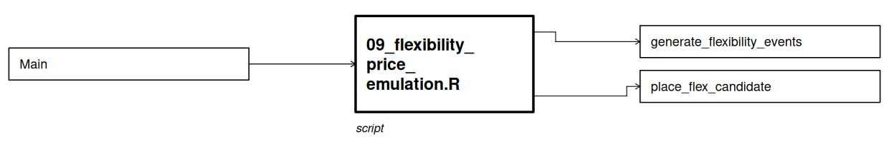

# 09_flexibility_price_emulation.R

**Script** &nbsp;·&nbsp; `30_Simulation/04_Scripts/09_flexibility_price_emulation.R`

## Function

Emulates the flexibility market when there is no real data for it: decides where and when flexibility events happen, and overwrites the flexibility price and probability columns of Main_df with generated values for them. It is sourced from Main.R only when parameters$debug_and_config$Price_emulation == 1, the flag its name comes from.
Columns overwritten in Main_df:

- Flex_unit_cost_down_com  – flexibility commitment price (down), EUR/kWh
- Flex_unit_cost_down_exec – flexibility execution price (down), EUR/kWh
- Flex_unit_cost_up_com    – flexibility commitment price (up), EUR/kWh
- Flex_unit_cost_up_exec   – flexibility execution price (up), EUR/kWh
- Flex_Probab_down         – downward flexibility execution probability (0–1)
- Flex_Probab_up           – upward flexibility execution probability (0–1)
- Flex_Act                 – 1 for every row covered by an accepted flexibility event, 0 otherwise

## Called by

- [Main.R](Main.md)

## What it calls, in order of appearance

- [generate_flexibility_events.R](generate_flexibility_events.md)
- [place_flex_candidate.R](place_flex_candidate.md)

## Input data

- Main_df    : Data frame. Must contain time and, in complex mode, the Sched_*/Pilot_* market timeline columns.
- parameters : List. Uses:
    - parameters$market: market_resolution, Complex_Market_Config and the Max_flex_* limits
    - parameters$flexibility_price_emulation, in complex mode

## Output data

- Main_df : Data frame. Updated with generated flexibility price columns.

## Other notes from the file header

### Two modes

Both place the start and the duration of every event on slots of parameters$market$market_resolution.

- Complex_Market_Config == "no" (basic): one independent candidate per period and calendar day, placed anywhere in the day's [0, 24 h) window by place_flex_candidate(), with these parameters of parameters$market:
- Max_flex_periods_day
- Max_flex_com_price
- Max_flex_exec_price
- Max_flex_period_duration
- Max_flex_probability_down
- Max_flex_probability_up

Complex_Market_Config == "yes" (market-aware): delegates to

- generate_flexibility_events(), whose header describes the full
- algorithm:
- Scheduling echo and candidates
- Piloting candidates with exponential decay

### Usage instructions

```r
source(file.path("30_Simulation", "04_Scripts", "09_flexibility_price_emulation.R"))
```

Not called: sourced by Main.R before the simulation loop, so the events exist before any market can sell flexibility on them.

### Code outline

1. Draw the flexibility events of the whole period.
2. Place each drawn event on the calendar, on the segments its day leaves free.
3. Write the resulting events into Main_df.

## Diagram



Also available as [09_flexibility_price_emulation.svg](09_flexibility_price_emulation.svg).

---

[Back to the code structure index](../Code_Structure.md)
