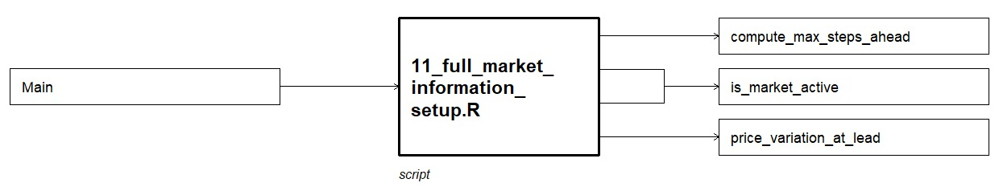

# 11_full_market_information_setup.R

**Script** &nbsp;·&nbsp; `30_Simulation/04_Scripts/11_full_market_information_setup.R`

## Function

Builds the future-horizon price matrices used by the market processes (Scheduling and Piloting) to look up energy and flexibility prices at each market step. Each price signal is stored as a data frame with one row per market event (a MarketUTC interval where a Scheduling or Piloting market actually clears, i.e. Main_df$Sched_Market_Name or Main_df$Pilot_Market_Name is active there) and one column per future step ahead of that event, named "0" (the event's own interval) to as.character(max_steps_ahead - 1). Column step j still refers to the market-resolution grid interval j steps ahead of the row's own MarketUTC, exactly as before; only the row set changed, from "every market-resolution interval" to "every market event". The thirteen data frames are bundled into a single named list, full_market_information (e.g. full_market_information$Elec_unit_cost_import_buy_df), which is the only object this script leaves in the global environment for this subsystem. Nine of the thirteen signals (Elec_unit_cost_distribution, used only by reward_function() via resolve_marginal_context(), and the eight flexibility buy/sell signals) are pass-through: the value assigned to a MarketUTC interval is simply the mean of the Main_df signal over all observations sharing that interval (step 3), then looked up per future step exactly as before (step 5). The remaining four (Elec_unit_cost_import/export_buy/sell) are NOT averaged from a flat Main_df column - they are computed cell by cell from Elec_unit_cost_buy (P_ref) using the discount formula given in 10_energy_price_signals_setup.R and parameters$energy_price, because factor_tiempo depends on h = j * market_resolution/60 (j = future-step column), which is not a property of a single Main_df row - see step 5. A flat per-row column therefore cannot represent this signal. The future-step column width (max_steps_ahead) is the distance from the bid time of the furthest-looking market to the end of its optimization horizon, in market_resolution steps. It is read from the market configuration in use (the basic markets of 03_Market_config.csv, or the market tables in complex mode) by compute_max_steps_ahead(). Sourced from Main.R, after 03_climate_priority.R and before 07_reference_temperature_profiles.R.

## Called by

- [Main.R](Main.md)

## What it calls, in order of appearance

- [compute_max_steps_ahead.R](compute_max_steps_ahead.md)
- [is_market_active.R](is_market_active.md) &nbsp;(2 call sites)
- [price_variation_at_lead.R](price_variation_at_lead.md)

## Input data

- Main_df, with its market columns and its twelve price signals.
- parameters$market, parameters$market_config_scheduling and parameters$market_config_piloting : the resolution and the horizons.
- parameters$energy_price : the variation of each price with the horizon it is quoted at.
- parameters$computing : the lead edges of the four price bands.

## Output data

- full_market_information, a list of data frames, one per price signal, with one row per market event and one column per step ahead.

## Other notes from the file header

### Code outline

1. Determine the furthest horizon any market looks at.
2. Build the market-resolution grid and locate the market events.
3. Average each price signal over every market interval.
4. Create the horizon data frames, with every cell missing (NA).
5. Fill them from those averages, discounted to the horizon.

### Usage instructions

Not called: sourced by Main.R before the simulation loop, which reads these prices at every market.

## Diagram

Also available as [11_full_market_information_setup.svg](11_full_market_information_setup.svg).

---

[Back to the code structure index](../Code_Structure.md)
