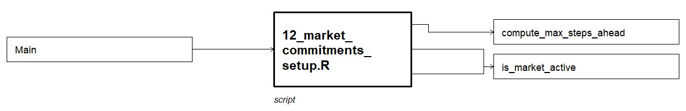

# 12_market_commitments_setup.R

**Script** &nbsp;·&nbsp; `30_Simulation/04_Scripts/12_market_commitments_setup.R`

## Function

Initialises the market output matrices that record, per market step, what the Scheduling and Piloting processes produce:

- the energy commitments (buy, sell and net)
- the flexibility commitments
- the accumulated differential costs

## Called by

- [Main.R](Main.md)

## What it calls, in order of appearance

- [compute_max_steps_ahead.R](compute_max_steps_ahead.md)
- [is_market_active.R](is_market_active.md) &nbsp;(2 call sites)

## Input data

- Main_df, whose market columns say where a market clears.
- parameters$market : the resolution and the horizons that size the matrices.

## Output data

- market_commitments, a list of matrices with one row per market event and one column per step ahead, holding:
    - the energy bought, sold and net
    - the two flexibility legs
    - the accumulated differential cost

## Other notes from the file header

### Flexibility commitments: up and down legs

A flexibility commitment is a service the building sells to the grid, and it has two independent legs: down-flexibility (a promise to reduce load on request) and up-flexibility (a promise to increase it). Each leg can be sold (a new or larger commitment) and bought back (unwinding part or all of a commitment sold in an earlier market), so four matrices are kept:

- Elec_flex_down_sell_plan_df - down-flexibility newly sold
- Elec_flex_down_buy_plan_df  - down-flexibility bought back
- Elec_flex_up_sell_plan_df   - up-flexibility newly sold
- Elec_flex_up_buy_plan_df    - up-flexibility bought back

Each leg has its own committed volume, and both are non-negative by construction: Main_df$Elec_flex_down_plan = Elec_total_plan - Elec_total_plan_flex_down over the Commitment Phase, the load the building commits to shed, and Main_df$Elec_flex_up_plan = Elec_total_plan_flex_up - Elec_total_plan over its own Commitment Phase, the load it commits to add. Each is recorded on its own pair of matrices; neither is read off the sign of the other. Every row corresponds to a market event (a MarketUTC interval where a Scheduling or Piloting market actually clears, i.e. Main_df$Sched_Market_Name or Main_df$Pilot_Market_Name is active there), and every future-step column holds the value committed for the market-resolution interval that many steps ahead of that event, exactly as before. Twelve data frames are created, each with one row per market event (column 'time') and one column per future step ahead, named "0" (the event's own interval) to as.character(max_steps_ahead - 1). All future-step cells are initialised to 0 (double); they are filled later by the market integration logic. Since the energy signals are aggregated by sum over each MarketUTC interval, the committed value written to an interval is the sum of the underlying commitments. The twelve data frames are bundled into a single named list, market_commitments (e.g. market_commitments$Elec_net_plan_df), which is the only object this script leaves in the global environment for this subsystem. max_steps_ahead is expected to be available from 11_full_market_information_setup.R; it is recomputed here as a safeguard if absent, using the same dynamic horizon derived from parameters$market_config_scheduling and parameters$market_config_piloting. Sourced from Main.R, right after 11_full_market_information_setup.R.

### Code outline

1. Locate the rows where a market actually clears.
2. Create every matrix at zero, sized by those rows and by the furthest horizon any market looks at.

### Usage instructions

Not called: sourced by Main.R before the simulation loop, which fills these matrices market by market.

## Diagram

Also available as [12_market_commitments_setup.svg](12_market_commitments_setup.svg).

---

[Back to the code structure index](../Code_Structure.md)
