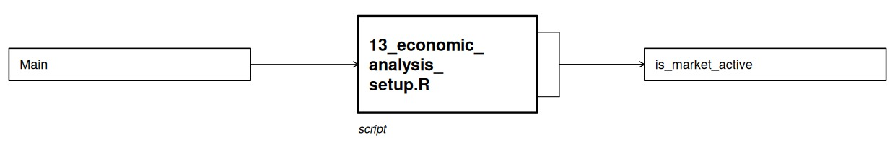

# 13_economic_analysis_setup.R

**Script** &nbsp;·&nbsp; `30_Simulation/04_Scripts/13_economic_analysis_setup.R`

## Function

Builds the empty skeleton of the economic analysis output, a named list called analysis with two data frames, market and slot. The market-decision flows are accumulated into them during the simulation loop by integrate_market_process.R; the execution-phase flows and every derived fraction are filled in at the end by 15_economic_analysis_finalize.R. Together the two tables give the global economic picture that the individual commitment/price matrices (market_commitments, full_market_information) do not provide on their own: those hold quantities, prices and costs per market event and future step, but nothing that adds up to "what did this market do, in total" or "what happened in this slot, in total".
economic_analysis$market - one row per market There is one row for every Scheduling market event, one row for every Piloting market event, and one row per market slot for Execution (Execution is not a market, so it is reported at the resolution at which it actually happens, one delivery slot at a time). Rows are ordered by time, and within the same timestamp by Scheduling, then Piloting, then Execution. Columns 4-12 hold the total (summed) value over all the slots on which that market operated.

economic_analysis$slot - one row per market slot One row per MarketUTC interval of the simulation, holding the energy actually delivered in that slot and the breakdown of how the position for that slot was built up across the markets that traded it.

Slot-to-market attribution when markets overlap A single slot is traded many times: by the Scheduling markets that cover it, by the Piloting markets that cover it, and finally at Execution. When more than one market clears at the same timestamp, each slot is attributed to exactly one of them, as follows:

- If a Scheduling market clears at that timestamp and the slot is inside its control horizon, the slot is attributed to that Scheduling market - whether the energy/economic flow was generated by the Scheduling decision or by the Piloting decision that cleared at the same timestamp.
- The slot being delivered is attributed to Execution, which is what the Execution rows report.
- Every remaining slot is attributed to the Piloting market.

## Called by

- [Main.R](Main.md)

## What it calls, in order of appearance

- [is_market_active.R](is_market_active.md) &nbsp;(2 call sites)

## Input data

- Main_df    : Data frame. Must already carry MarketUTC and the Sched_*/Pilot_* market timeline columns (i.e. this script runs after 08_market_columns_setup.R).
- parameters : Named list. Only parameters$debug_and_config$verbose is read, to gate the console summary at the end.

## Output data

- analysis : Named list of 3 elements, with every accumulator column of market/slot initialised to 0:
    - market and slot: the two data frames that make up the final output
    - index: working row-lookup state, dropped by 15_economic_analysis_finalize.R before export (see block 5 below)

## Other notes from the file header

### Code outline

1. Market slots of the simulation
2. Row set of economic_analysis$market: Scheduling, Piloting and Execution rows
3. Initialise economic_analysis$market accumulators
4. Initialise economic_analysis$slot accumulators
5. Row lookup index

### Usage instructions

```r
source(file.path("30_Simulation", "04_Scripts", "13_economic_analysis_setup.R"))
```

Not called: sourced by Main.R before the simulation loop, to create the accumulators the loop fills.

## Diagram



Also available as [13_economic_analysis_setup.svg](13_economic_analysis_setup.svg).

---

[Back to the code structure index](../Code_Structure.md)
