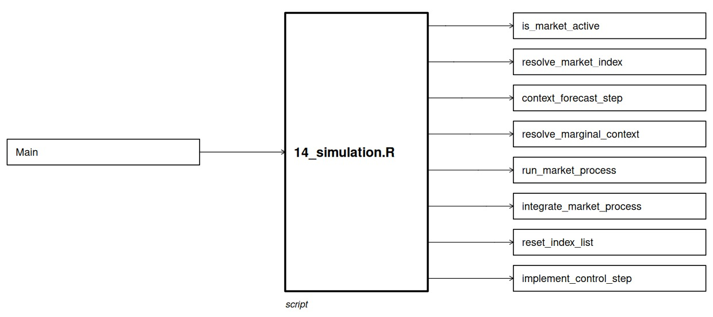

# 14_simulation.R

**Script** &nbsp;·&nbsp; `30_Simulation/04_Scripts/14_simulation.R`

## Function

This script implements the main MPC simulation loop. For each MarketUTC step (row in Main_df), it performs:

1) Scheduling process (if Sched_Market_Name != 0)

2) Piloting process   (if Pilot_Market_Name != 0)

3) Execution process  (always)

Scheduling and Piloting each integrate their market result the same way (via integrate_market_process.R): first as a differential energy commitment accumulated into market_commitments (its twelve tables are listed under Inputs), using the market row/column mapping given by market_time and the per-interval SUM aggregation of:

- Elec_total_plan
- Elec_total_plan_flex_down
- Elec_flex_down_plan

then as the usual absolute update of the *_plan/*_plan_flex_down columns of Main_df; then as the net cash flow of the explicit flexibility service (both down and up legs, value_flex_operation() - registered for both Scheduling and Piloting) and of the base energy commitment (calc_differential_cost(), the same track for Scheduling and Piloting), each accumulated into its own market_commitments cost matrix and propagated unit-value-per- timestamp into Main_df$Elec_flex_commitment_revenue_h and Elec_market_net_cost_h respectively. The same two differentials are also broken into their elementary operations (value_flex_operation()/split_market_operation()) and summed, on the market's own row, into Main_df$Elec_flex_sell_revenue_market/ Elec_flex_purchase_cost_market and Elec_sell_revenue_market/ Elec_purchase_cost_market. Every one of these signals follows the same sign convention: income positive, expense negative.

## Called by

- [Main.R](Main.md)

## What it calls, in order of appearance

- [is_market_active.R](is_market_active.md) &nbsp;(2 call sites)
- [resolve_market_index.R](resolve_market_index.md) &nbsp;(8 call sites)
- [context_forecast_step.R](context_forecast_step.md) &nbsp;(2 call sites)
- [resolve_marginal_context.R](resolve_marginal_context.md) &nbsp;(2 call sites)
- [run_market_process.R](run_market_process.md) &nbsp;(2 call sites)
- [integrate_market_process.R](integrate_market_process.md) &nbsp;(2 call sites)
- [reset_index_list.R](reset_index_list.md) &nbsp;(12 call sites)
- [implement_control_step.R](implement_control_step.md)

## Input data

- Main_df : Data frame. The main simulation data frame.
- parameters : List. Complete parameters list with all sub-lists.
- market_commitments : Named list of 12 data frames, one row per market event, created by 12_market_commitments_setup.R:
    - Elec_buy_plan_df
    - Elec_sell_plan_df
    - Elec_net_plan_df
    - Elec_buy_plan_flex_down_df
    - Elec_sell_plan_flex_down_df
    - Elec_net_plan_flex_down_df
    - Elec_flex_down_sell_plan_df
    - Elec_flex_down_buy_plan_df
    - Elec_flex_up_sell_plan_df
    - Elec_flex_up_buy_plan_df
    - Elec_Cost_plan_df
    - Elec_flex_Cost_plan_df
- full_market_information : Named list of 13 data frames, one row per market event, created by 11_full_market_information_setup.R:
    - Elec_unit_cost_import_buy_df
    - Elec_unit_cost_import_sell_df
    - Elec_unit_cost_export_buy_df
    - Elec_unit_cost_export_sell_df
    - Elec_unit_cost_distribution_df
    - Flex_unit_cost_{down,up}_{com,exec}_{buy,sell}_df (eight tables, one per combination of leg, price type and side)
- economic_analysis : Named list of economic analysis accumulators, created by 13_economic_analysis_setup.R:
    - market
    - slot
    - index

## Output data

- Main_df : Data frame. Updated with simulation results, including the incrementally propagated Elec_market_net_cost_h and Elec_flex_commitment_revenue_h columns, the lump-sum Elec_purchase_cost_market/Elec_sell_revenue_market/ Elec_flex_purchase_cost_market/Elec_flex_sell_revenue_market columns, and (row by row, at Execution) Elec_total_no_flex.
- execution_time : List. Timing information for the simulation.
- market_commitments : Updated in place with the differential energy and cost commitments of every Scheduling and Piloting market executed during the simulation.
- economic_analysis : Updated in place with the elementary market operations of every Scheduling and Piloting market executed during the simulation.

## Other notes from the file header

### Code outline

1. Data frame formatting (ensure needed columns exist)
2. Model initialization (set initial temperatures)
3. Compute auxiliary variables, the market-interval index (market_time) and create simulation_control object
4. Main simulation loop:
    - 4.0 Load Scheduling/Piloting market parameters for each row
    - 4.1 Scheduling process (conditional): differential energy into the market commitments, absolute Main_df update, then differential cash flow of the explicit flexibility service and of the base energy commitment
    - 4.2 Piloting process (conditional): differential energy into the market commitments, absolute Main_df update, then differential cash flow of the explicit flexibility service and of the base energy commitment
    - 4.3 Execution process (always): implement_control_step() also fixes Elec_total_no_flex for the executed rows
    - 4.4 Track execution progress

### Usage instructions

```r
source(file.path("30_Simulation", "04_Scripts", "14_simulation.R"))
```

Not called: sourced by Main.R once every setup step has run. It is the simulation loop itself.

## Diagram



Also available as [14_simulation.svg](14_simulation.svg).

---

[Back to the code structure index](../Code_Structure.md)
