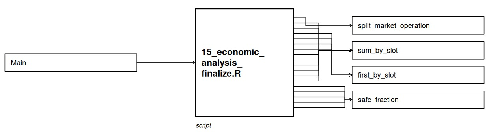

# 15_economic_analysis_finalize.R

**Script** &nbsp;·&nbsp; `30_Simulation/04_Scripts/15_economic_analysis_finalize.R`

## Function

Completes the economic analysis tables once the simulation loop is over. The Scheduling and Piloting flows were already accumulated during the loop by integrate_market_process.R; this script adds the execution-phase flows, which can be derived from Main_df in one pass at the end, and turns the working quantities into the reported fractions, whose denominators are only known once every market has traded.

## Called by

- [Main.R](Main.md)

## What it calls, in order of appearance

- [split_market_operation.R](split_market_operation.md)
- [sum_by_slot.R](sum_by_slot.md) &nbsp;(8 call sites)
- [first_by_slot.R](first_by_slot.md) &nbsp;(4 call sites)
- [safe_fraction.R](safe_fraction.md) &nbsp;(5 call sites)

## Input data

- analysis   : Named list. The accumulators built by 13_economic_analysis_setup.R and filled during the simulation loop.
- Main_df    : Data frame. The simulation results.
- parameters : Named list. Only parameters$debug_and_config$verbose is read, to gate the console summary at the end.

## Output data

- analysis : Named list of 2 data frames (market, slot), with every reported column filled in and the working columns and the index sub-list removed.

## Other notes from the file header

### The execution phase

Execution is not a market: it is the physical delivery of energy, and it deviates from the last committed plan because the building does not behave exactly as forecast. Its economics are therefore the move from the last committed position (Elec_total_plan) to what was actually delivered (Elec_total_exec), valued at that slot's own import/export prices, resolved here into its four elementary operations instead of a single net number. The move is netted per market slot before it is resolved: energy is traded per slot, so only the slot's net adjustment is a real market operation. A deviation that merely shifts energy from one timestep to another inside the same slot leaves the slot's position almost unchanged and must not be reported as a purchase plus a matching sale. implement_control_step.R still prices the same deviation per timestep into Elec_deviations_net_cost_h; that column is a per-timestep cost signal, not a market operation, so the two are expected to differ whenever a slot's timesteps offset each other.

### Cost and revenue of an unwinding operation

Only a new purchase is a cost and only a new sale is a revenue. A resale undoes an earlier purchase and is therefore an avoided cost (it reduces Cost_energy_bought); a rebuy undoes an earlier sale and is an avoided revenue (it reduces Revenue_energy_sold). Neither is reported as a flow of the opposite kind - see accumulate_market_operation()'s header, which applies the same rule to the Scheduling and Piloting flows. Cash_flow is identical either way; only the split between cost and revenue changes.

### Executed flexibility

Flexibility execution is not simulated yet: the building always delivers its baseline plan, and no flexibility activation is ever booked. The two Main_df signals reserved for it, Elec_flex_execution_revenue_h and Elec_flex_deviations_net_cost_h, are consequently zero for every row. The executed volume is computed from them, as the committed down-flexibility volume of the rows on which the execution phase actually booked a flexibility activation, so columns 14 and 15 of economic_analysis$market and the corresponding slot figures all come out as 0 today, and will report real values without any further change once flexibility execution is implemented.

### Code outline

1. Slot of every row, and slots of the analysis
2. Execution-phase operations, per market slot
3. Fill the Execution rows of economic_analysis$market
4. Fill the remaining economic_analysis$slot columns
5. Derive the reported fractions
6. Drop the working columns and the index

### Usage instructions

```r
source(file.path("30_Simulation", "04_Scripts", "15_economic_analysis_finalize.R"))
```

Not called: sourced by Main.R after the simulation loop, to close the accounting the loop accumulated.

## Diagram



Also available as [15_economic_analysis_finalize.svg](15_economic_analysis_finalize.svg).

---

[Back to the code structure index](../Code_Structure.md)
