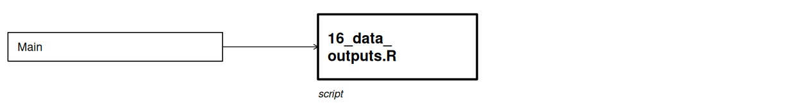

# 16_data_outputs.R

**Script** &nbsp;·&nbsp; `30_Simulation/04_Scripts/16_data_outputs.R`

## Function

This script exports the simulation results to CSV and RDS files. It is sourced from Main.R.

## Called by

- [Main.R](Main.md)

## What it calls, in order of appearance

- Nothing: this piece calls no other piece of the project.

## Input data

- Main_df : Data frame. Simulation results.
- parameters : List. Contains optimization sub-list.
- execution_time : List. Timing information.
- economic_analysis : List of 2 data frames (market, slot), as completed by 15_economic_analysis_finalize.R.
- paths : List. Must include paths$output_path (path to the output directory).

## Output data

- (none) - writes CSV and RDS files to output_path.

## Other notes from the file header

### Sinthetized_df

One row per simulation, reconstructable in full from its own columns: every money column follows the repository's sign convention (income positive, expense negative), so Elec_cost + Elec_revenue + Flex_plan_revenue + Distr_cost is the energy-and-flexibility economic result of the year, before comfort. The market-decision (Scheduling/Piloting) and execution-deviation money flows are not split apart into their own columns here - the per-market, per-slot breakdown is economic_analysis$market/economic_analysis$slot, exported separately below.

- Comfort             = sum(Comfort_exec): occupied timesteps in comfort.
- Elec_total_in       = sum(pmax(Elec_total_exec, 0)): energy imported.
- Elec_total_out      = sum(pmax(-Elec_total_exec, 0)): energy exported.
- Flex_plan_down      = sum(Elec_flex_down_plan): down-flexibility committed.
- Flex_plan_up        = sum(Elec_flex_up_plan): up-flexibility committed. Each leg has its own signal, and both are non-negative by construction, so neither is read off the sign of the other.
- Flex_exec_down/up   = the same two legs, restricted to timesteps where flexibility was actually executed (never true today: flexibility execution is not simulated, so both are always 0; see 15_economic_analysis_finalize.R's identical logic).
- Elec_cost           = -sum(economic_analysis$slot$Cost_energy_bought): net spent buying energy, across Scheduling, Piloting and Execution, with every resale subtracted as the avoided cost it is.
- Elec_revenue        = sum(economic_analysis$slot$Revenue_energy_sold): net received selling energy, with every rebuy subtracted as the avoided revenue it is. A simulation that never exports therefore reports Elec_revenue = 0, instead of counting its resales as income - see accumulate_market_operation()'s header.
- Flex_plan_revenue   = sum(economic_analysis$slot$Revenue_flex_commitments): net cash flow of flexibility commitments (sold minus bought back), across Scheduling and Piloting.
- Flex_exec_revenue   = sum(economic_analysis$market$Flex_executed_cash_flow) on Execution rows: always 0 today, for the same reason as Flex_exec_down/up.
- Distr_cost          = sum(economic_analysis$slot$Distribution_cost): already negative (see implement_control_step.R).
- Reward              = sum(Reward): the GA's own optimization target.
- Process_time        = execution_time$t_process (seconds).

parameters$optimization is kept as the leading columns, unchanged from earlier versions of this table, so that parametric-simulation batches can still be compared by hyperparameter.

### Code outline

1. Create output directory if needed
2. Export Main_df to CSV and RDS
3. Build and export synthesized summary data frame
4. Export the two economic analysis tables

### Usage instructions

```r
source(file.path("30_Simulation", "04_Scripts", "16_data_outputs.R"))
```

Not called: sourced by Main.R as its last step, once the simulation and the economic analysis have finished.

## Diagram



Also available as [16_data_outputs.svg](16_data_outputs.svg).

---

[Back to the code structure index](../Code_Structure.md)
