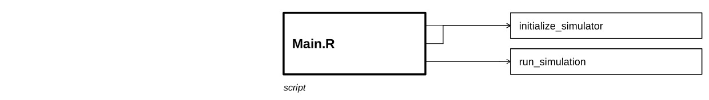

# Main.R

**Script** &nbsp;·&nbsp; `30_Simulation/Main.R`

## Function

Entry point of the simulation of a Model Predictive Control (MPC) strategy applied to building energy management. It loads the simulator into an environment of its own and runs the whole simulation on the configuration folder of the repository. What the simulation does, step by step, is described in the header of run_simulation().

## Called by

- Nothing calls it: this is the entry point of the simulation.

## What it calls, in order of appearance

- [initialize_simulator.R](initialize_simulator.md) &nbsp;(2 call sites)
- [run_simulation.R](run_simulation.md)

## Input data

- 30_Simulation/02_Config/ : every configuration file, with the file names listed in 04_File_paths.csv and their validation tables in 00_Validation/.
- 30_Simulation/01_Data/   : Meteo_df.rds and Energy_Prices_df.rds, the input series.

## Output data

- 30_Simulation/90_Output/ : the output tables, each as .csv and .rds, written by write_outputs():
    - Main_df_computed
    - <asset_id>_df_computed, one per asset (Building_001_df_computed)
    - Sinthetized_df_computed
    - Economic_analysis_market_computed
    - Economic_analysis_decision_computed
    - Economic_analysis_slot_computed
- results : List. The final results of the run, as returned by run_simulation(), left in the global environment.
- sim     : Environment. The simulator, left in the global environment.

## Other notes from the file header

### Code outline

1. Load the simulator
2. Run the simulation

### Usage instructions

From the repository root:

- Rscript 30_Simulation/Main.R

It is the only file of the simulation meant to be run directly.

## Diagram

Also available as [Main.svg](Main.svg).

---

[Back to the code structure index](../Code_Structure.md)
