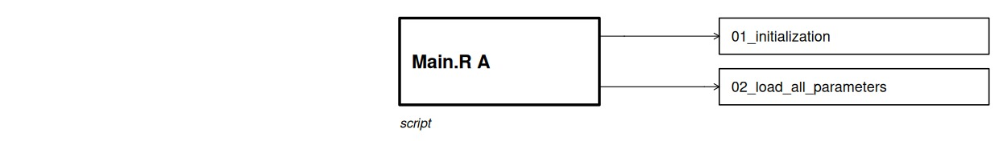

# Main.R &mdash; A. Initialization & parameter loading

Block A of [Main.R](Main.md), steps 1 to 2.

## Steps

- **1.** Initialization &mdash; [01_initialization.R](01_initialization.md)
- **2.** Load data and model parameters &mdash; [02_load_all_parameters.R](02_load_all_parameters.md)

## Diagram

Also available as [Main__A.svg](Main__A.svg).

---

[Back to Main.R](Main.md) &nbsp;·&nbsp; [Back to the code structure index](../Code_Structure.md)
