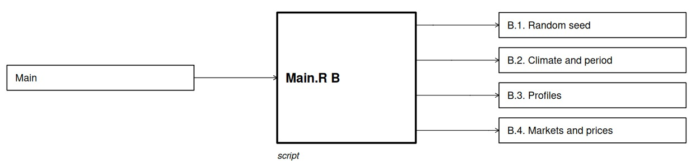

# Main.R &mdash; B. Pre-processing

Block B of [Main.R](Main.md), steps 3 to 14.

## Steps

- **3.** Fix the random seed (reproducibility of the whole run) &mdash; inline code in Main.R
- **4.** Climate priority (before subsetting, needs full-year trailing averages) &mdash; [03_climate_priority.R](03_climate_priority.md)
- **5.** Subset Main_df by month / period &mdash; [04_subset_main_df.R](04_subset_main_df.md)
- **6.** Generate occupancy profiles &mdash; [05_generate_occupancy_profiles.R](05_generate_occupancy_profiles.md)
- **7.** Generate scheduling profiles &mdash; [06_generate_scheduling_profiles.R](06_generate_scheduling_profiles.md)
- **8.** Reference temperature profiles &mdash; [07_reference_temperature_profiles.R](07_reference_temperature_profiles.md)
- **9.** Initialise market columns in Main_df &mdash; [08_market_columns_setup.R](08_market_columns_setup.md)
- **10.** Flexibility generation (conditional) &mdash; [09_flexibility_price_emulation.R](09_flexibility_price_emulation.md)
- **11.** Energy/flexibility price signals (buy/sell derivation) &mdash; [10_energy_price_signals_setup.R](10_energy_price_signals_setup.md)
- **12.** Build future-horizon price matrices &mdash; [11_full_market_information_setup.R](11_full_market_information_setup.md)
- **13.** Initialise market output matrices (market commitments) &mdash; [12_market_commitments_setup.R](12_market_commitments_setup.md)
- **14.** Initialise the economic analysis accumulators &mdash; [13_economic_analysis_setup.R](13_economic_analysis_setup.md)

## Parts

The steps of the block are organised in 4 groups:

- [B.1. Random seed](Main__B_1.md) &nbsp;(step 3)
- [B.2. Climate and period](Main__B_2.md) &nbsp;(steps 4 to 5)
- [B.3. Profiles](Main__B_3.md) &nbsp;(steps 6 to 8)
- [B.4. Markets and prices](Main__B_4.md) &nbsp;(steps 9 to 14)

## Diagram

Also available as [Main__B.svg](Main__B.svg).

---

[Back to Main.R](Main.md) &nbsp;·&nbsp; [Back to the code structure index](../Code_Structure.md)
