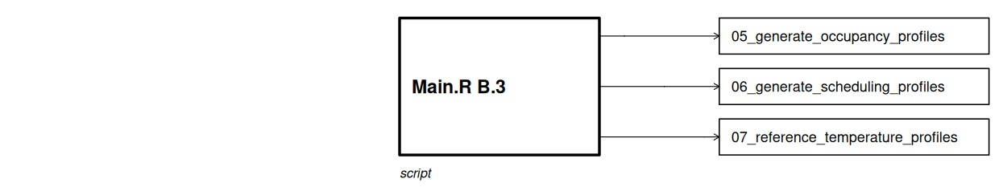

# Main.R &mdash; B.3. Profiles

Part 3 of 4 of block [B. Pre-processing](Main__B.md) of [Main.R](Main.md).

## Steps

- **6.** Generate occupancy profiles &mdash; [05_generate_occupancy_profiles.R](05_generate_occupancy_profiles.md)
- **7.** Generate scheduling profiles &mdash; [06_generate_scheduling_profiles.R](06_generate_scheduling_profiles.md)
- **8.** Reference temperature profiles &mdash; [07_reference_temperature_profiles.R](07_reference_temperature_profiles.md)

## Diagram

Also available as [Main__B_3.svg](Main__B_3.svg).

---

[Back to block B](Main__B.md) &nbsp;·&nbsp; [Back to Main.R](Main.md) &nbsp;·&nbsp; [Back to the code structure index](../Code_Structure.md)
