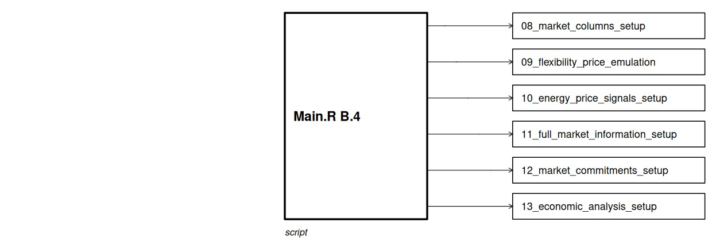

# Main.R &mdash; B.4. Markets and prices

Part 4 of 4 of block [B. Pre-processing](Main__B.md) of [Main.R](Main.md).

## Steps

- **9.** Initialise market columns in Main_df &mdash; [08_market_columns_setup.R](08_market_columns_setup.md)
- **10.** Flexibility generation (conditional) &mdash; [09_flexibility_price_emulation.R](09_flexibility_price_emulation.md)
- **11.** Energy/flexibility price signals (buy/sell derivation) &mdash; [10_energy_price_signals_setup.R](10_energy_price_signals_setup.md)
- **12.** Build future-horizon price matrices &mdash; [11_full_market_information_setup.R](11_full_market_information_setup.md)
- **13.** Initialise market output matrices (market commitments) &mdash; [12_market_commitments_setup.R](12_market_commitments_setup.md)
- **14.** Initialise the economic analysis accumulators &mdash; [13_economic_analysis_setup.R](13_economic_analysis_setup.md)

## Diagram

Also available as [Main__B_4.svg](Main__B_4.svg).

---

[Back to block B](Main__B.md) &nbsp;·&nbsp; [Back to Main.R](Main.md) &nbsp;·&nbsp; [Back to the code structure index](../Code_Structure.md)
