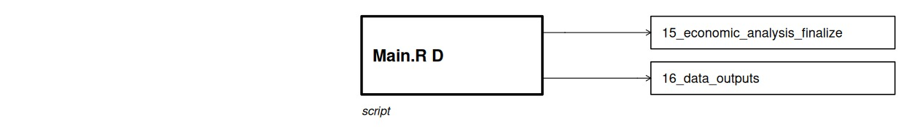

# Main.R &mdash; D. Post-process & Export

Block D of [Main.R](Main.md), steps 16 to 17.

## Steps

- **16.** Complete the economic analysis (execution phase and fractions) &mdash; [15_economic_analysis_finalize.R](15_economic_analysis_finalize.md)
- **17.** Export results to files &mdash; [16_data_outputs.R](16_data_outputs.md)

## Diagram

Also available as [Main__D.svg](Main__D.svg).

---

[Back to Main.R](Main.md) &nbsp;·&nbsp; [Back to the code structure index](../Code_Structure.md)
