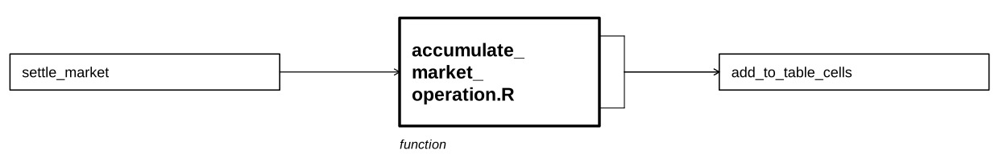

# accumulate_market_operation.R

**Function** &nbsp;·&nbsp; `30_Simulation/03_Functions/accumulate_market_operation.R`

## Function

Adds the energy market operations of one market - the move it made on each of its target slots, already resolved into its four elementary components by split_market_operation() - to the two economic_analysis tables, slot by slot, in the order of the slots. It is the single place where a market flow becomes a reported number, so that economic_analysis$market and economic_analysis$slot cannot drift apart from each other or from the commitment matrices. The same operation is reported twice, from two different angles:

- on one row of economic_analysis$market: the market that owns this slot, which accumulates the operation's quantities and its cash flow.
- on one row of economic_analysis$slot: the slot itself, which accumulates the operation's costs, revenues and the working quantities that finalize() later turns into fractions.

## Called by

- [settle_market.R](settle_market.md)

## What it calls, in order of appearance

- [add_to_table_cells.R](add_to_table_cells.md) &nbsp;(2 call sites)

## Input data

- economic_analysis : Named list. The accumulators, as built by prepare_economic_analysis().
- operation     : Named list. One split_market_operation() result, with one element per target slot.
- dest_row      : Integer vector, one element per target slot. Row of economic_analysis$market that reports each slot, already resolved by the attribution rule in settle_market.R. Several slots can share a row.
- dest_slot     : Integer vector, one element per target slot. Row of economic_analysis$slot for each slot; no two slots share a row.
- is_scheduling : Logical. TRUE when the decision producing this operation is a Scheduling market. Only used to feed the "committed in Scheduling" working quantity of economic_analysis$slot; it is independent of dest_row, because a Piloting decision can be reported on a Scheduling row when that market owns the slot.

## Output data

- Named list. The updated economic_analysis accumulators. Its tables are changed in place (add_to_table_cells()), so the tables of the economic_analysis passed in hold the same values.

## Other notes from the file header

### Sign convention

Cash_flow is signed as an inflow: selling energy (either a new sale or reselling something bought in an earlier market) brings money in and adds to it; buying energy (either a new purchase or buying back something sold in an earlier market) takes money out and subtracts from it. PL_rebuy_resale applies the same convention to the unwinding operations alone, so it is the net cash flow produced by undoing earlier positions, valued at the prices of the market that undid them.

### Where an unwinding operation is reported

The four elementary operations are not two costs and two revenues. Only a new purchase is a cost and only a new sale is a revenue; the other two undo an earlier position and are reported as a reduction of the flow they cancel, not as a flow of the opposite kind:

- a resale (selling back something bought earlier) is an avoided cost, so it reduces Cost_energy_bought;
- a rebuy (buying back something sold earlier) is an avoided revenue, so it reduces Revenue_energy_sold.

Reporting them the other way round would create revenue in a slot where no energy was ever exported (and cost where none was imported). A consequence of this is that Cost_energy_bought and Revenue_energy_sold are not always non-negative magnitudes: a slot whose position was mostly unwound reports a negative cost (net avoided cost) or a negative revenue (net avoided revenue).

### Code outline

1. Aggregate the four elementary components into cost, revenue and their unwinding-only counterparts
2. Accumulate on the owning economic_analysis$market row, in place
3. Accumulate on the economic_analysis$slot row, in place

### Usage instructions

```r
economic_analysis <- accumulate_market_operation(economic_analysis, operation,
  dest_row, dest_slot, is_scheduling)
```

## Diagram



Also available as [accumulate_market_operation.svg](accumulate_market_operation.svg).

---

[Back to the code structure index](../Code_Structure.md)
