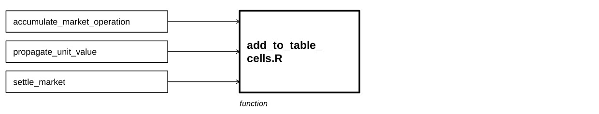

# add_to_table_cells.R

**Function** &nbsp;·&nbsp; `30_Simulation/03_Functions/add_to_table_cells.R`

## Function

Adds values to cells of an accumulator table, in place. The accumulator tables are the tables that the simulation loop adds the result of each market to:

- the twelve tables of market_commitments
- the market, decision and slot tables of economic_analysis

The cells are read and written in the table itself, with set() of data.table, so no column is copied. A table of the loop has one row per market event or per market slot of the whole simulation, so copying a column at every addition, as an ordinary assignment does, would cost more the longer the simulation is. The values are added in the order they are given. When a cell receives several values, they are added to it one after the other, as a sequence of ordinary assignments would do, so the result is the same to the last bit. Because the table is changed in place, every object that holds the same table sees the change. The accumulator tables are built with columns of their own (prepare_commitments() and prepare_economic_analysis() copy them), so no other object shares their columns.

## Called by

- [accumulate_market_operation.R](accumulate_market_operation.md)
- [propagate_unit_value.R](propagate_unit_value.md)
- [settle_market.R](settle_market.md)

## What it calls, in order of appearance

- Nothing: this piece calls no other piece of the project.

## Input data

- table   : Data frame. The accumulator table. Its columns must be numeric (double).
- rows    : Integer vector. The row of each cell.
- columns : Character vector. The column of each cell.
- values  : Numeric vector. The value to add to each cell.
- rows, columns and values are recycled to the longest of them, so that, for example, one row and several columns give one cell per column.

## Output data

- The same table, invisibly, with the values added to its cells. The table passed in is changed too.

## Other notes from the file header

### Code outline

1. One entry per cell, and the current value of each cell (with no cell, the table is returned as it is)
2. The new value of each cell, adding its values in order
3. Write the new values, in place

### Usage instructions

```r
add_to_table_cells(
  table   = economic_analysis$slot,
  rows    = slot_pos,
  columns = "Cash_flow",
  values  = cash_flow
  )
```

## Diagram



Also available as [add_to_table_cells.svg](add_to_table_cells.svg).

---

[Back to the code structure index](../Code_Structure.md)
