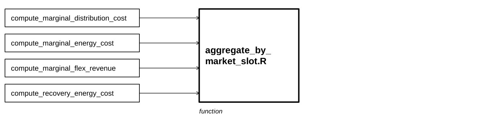

# aggregate_by_market_slot.R

**Function** &nbsp;·&nbsp; `30_Simulation/03_Functions/aggregate_by_market_slot.R`

## Function

Adds up a per-timestep quantity into one total per market slot, which is the unit every marginal cost and revenue is valued on.

The three functions that value a candidate - the marginal energy cost, the marginal distribution cost and the marginal flexibility revenue - all needed this same total, and all three used to compute it by walking the market slots and masking the candidate once per slot. That walk compared two POSIXct vectors on every step, which enters Ops.POSIXt and, with lubridate loaded, the S4 dispatch of is.Date. On a period of 865 slots it accounted for the largest single share of the run.

Why the sum is not vectorised further
Floating point addition is not associative, so the order the terms are added in decides the last bit of the result. split() hands each group to sum() in the same row order the masking did, which is what makes this function return exactly the same numbers as the walk it replaces, bit for bit. rowsum() is faster still and does NOT: it differs by one unit in the last place, and a search that compares candidates can turn that into a different optimum.

## Called by

- [compute_marginal_distribution_cost.R](compute_marginal_distribution_cost.md)
- [compute_marginal_energy_cost.R](compute_marginal_energy_cost.md)
- [compute_marginal_flex_revenue.R](compute_marginal_flex_revenue.md)
- [compute_recovery_energy_cost.R](compute_recovery_energy_cost.md)

## What it calls, in order of appearance

- Nothing: this piece calls no other piece of the project.

## Input data

- values     : Numeric vector, one entry per timestep of the candidate.
- slot_index : Factor, the same length as values, whose levels are the market slots in the order the totals are wanted. Built by market_slot_index() from the candidate's MarketUTC and the target market instants.

## Output data

- Numeric vector, one entry per level of slot_index, in that order. A slot no timestep belongs to contributes zero, as the masking walk did.

## Other notes from the file header

### Code outline

1. Split the values by slot and add each group up.

### Usage instructions

```r
slot_index <- market_slot_index(period_chunk$MarketUTC, market_utc)
```

```r
totals     <- aggregate_by_market_slot(E_candidate, slot_index)
```

## Diagram



Also available as [aggregate_by_market_slot.svg](aggregate_by_market_slot.svg).

---

[Back to the code structure index](../Code_Structure.md)
