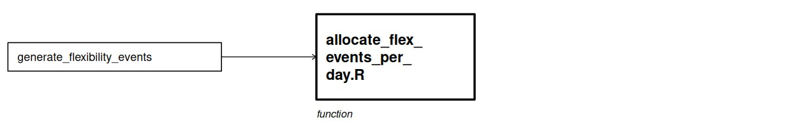

# allocate_flex_events_per_day.R

**Function** &nbsp;·&nbsp; `30_Simulation/03_Functions/allocate_flex_events_per_day.R`

## Function

Decides how many flexibility candidates each market event may place, by drawing a number of events for each calendar day and sharing it out among the markets of that day.

## Called by

- [generate_flexibility_events.R](generate_flexibility_events.md)

## What it calls, in order of appearance

- Nothing: this piece calls no other piece of the project.

## Input data

- day             : Vector, one entry per market event. The calendar day the event belongs to, as returned by as.Date() on the start of its control horizon. Midnight belongs to the day that starts, not to the one that ends.
- weight          : Numeric vector, same length. The extension of each market's optimization horizon, in any unit as long as it is the same for all of them. It is what the share is proportional to.
- trades_flex     : Logical vector, same length. TRUE for a market that trades flexibility, alone or with energy. A market that does not trade it takes no share.
- max_periods_day : Numeric scalar. Max_flex_periods_day.

## Output data

- Integer vector, same length as day: how many candidates each market event may place. It sums, within each day, to the number drawn for that day.

## Other notes from the file header

### Why the day comes first

Max_flex_periods_day is a cap per calendar DAY. Letting every market draw against a cap of its own makes the day carry as many events as it has markets: with the production table of twenty-four hourly Piloting markets, a cap of two events a day allowed six, as measured in simulation. The number is therefore drawn once per day and then shared, so the cap binds where it is declared.

### How a fractional share is settled

Sequentially, probabilistically, and re-fractioned at every step:

1. The markets are ordered from the largest share to the smallest.
2. The first takes the WHOLE part of its share. A share of 1.4 events gives 1.
3. The REMAINDER, 0.4 in that example, is used as the probability of one more event: a forty per cent chance of adding one.
4. What that market gets is the sum of the two.
5. What it got is taken off the day's total and what is left is re-fractioned among the markets not yet settled.
6. And so on, through all of them.

The property that makes this work is at the end of the walk: when one market is left, its share is exactly what remains, the remainder is zero and it takes everything. The day's total is conserved without any correction, no event is lost to rounding, and no market is systematically favoured, because every step is a draw and not a rule.

### Code outline

1. One draw per day, and the eligible markets of that day
2. The sequential share-out

### Usage instructions

```r
quota <- allocate_flex_events_per_day(day, weight, trades_flex, max_periods_day)
```

### Exceptions and special cases

- A day whose markets none of them trade flexibility gets nothing, and so does a day whose draw comes out zero.
- A market with an extension of zero or less takes no share: it has no horizon to place anything in.
- Partial days at the start and the end of the simulated period are treated as any other day: the number of events is drawn and shared among the markets that are there. Prorating the draw by the fraction of day simulated would add machinery for the sake of the two days at the edges of the simulated period.
- The share-out is sequential, so each step conditions the next and proportionality is very close but not exact. Measured over 20000 days on the production table the observed shares follow the expected ones to the third figure.

## Diagram



Also available as [allocate_flex_events_per_day.svg](allocate_flex_events_per_day.svg).

---

[Back to the code structure index](../Code_Structure.md)
