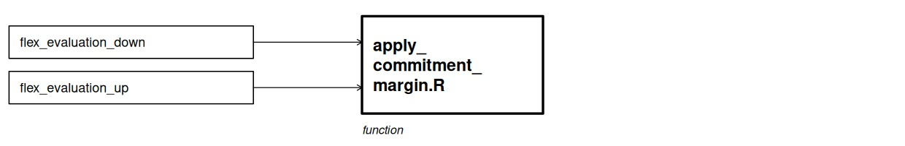

# apply_commitment_margin.R

**Function** &nbsp;·&nbsp; `30_Simulation/03_Functions/apply_commitment_margin.R`

## Function

Keeps an electrical headroom on a flexibility itinerary, so that a later re-optimization still has room to move the operation without breaking a commitment that was already sold.

Why the headroom exists
A flexibility window is sold against a concrete itinerary. Every market that clears afterwards derives that itinerary again, and if the new one can no longer sustain what was sold, the run is penalised as technically infeasible. The itinerary that leaves no room at all - the upward one pinned at the system's limit, the downward one pinned at zero - is the one that cannot absorb any change, however small. Leaving flexibility_commitment_margin of electricity unused on both sides is what gives the next market something to work with.

Where the headroom is measured

On the market slot, which is the unit that is traded and settled, and not on the individual timestep. A slot meets the rule when the electricity its rows add up to stays inside the band; a single step may sit at the limit as long as another step of the same slot makes up for it.

The two rules

Upward: the electricity of the slot must stay below what the system would draw at the ceiling the window is built against, by at least the margin. When the plan itself is already above that threshold the slot has no upward service to offer and its itinerary is left equal to the plan.

Downward: the electricity of the slot must stay above the margin. When the plan itself is already below it the slot has no downward service to offer and its itinerary is left equal to the plan.

How a slot is brought back inside the band

By scaling that slot's whole departure from the plan by a single factor between 0 and 1, on both systems at once, so the itinerary keeps its shape and only its depth changes. The electricity of a step is a monotone, piecewise linear function of the heat of that step - see elec_from_heat() below, which mirrors period_simulation_cpp.cpp - so the electricity of the slot is monotone in the factor and a bisection on the closed form finds it without simulating anything.

## Called by

- [flex_evaluation_down.R](flex_evaluation_down.md)
- [flex_evaluation_up.R](flex_evaluation_up.md)

## What it calls, in order of appearance

- Nothing: this piece calls no other piece of the project.

## Input data

- All the vectors are the same length, one entry per row of the Commitment Phase, and all the heat quantities are energies in kWh.
- Q_heat_flex    : Numeric vector. Heating of the itinerary the caller built, before the margin.
- Q_heat_plan    : Numeric vector. Heating of the plan on those rows.
- Q_cool_flex    : Numeric vector. Cooling of the itinerary.
- Q_cool_plan    : Numeric vector. Cooling of the plan.
- Q_heat_ceiling : Numeric vector. Heating the window is built against at its ceiling, zero when the window does not use the heating system. Only read when leg is "up".
- Q_cool_ceiling : Numeric vector. The same for cooling.
- market_slot    : Vector. The market slot each row belongs to.
- Text           : Numeric vector. Outdoor temperature, for the COP.
- delta_t_h      : Numeric vector. Timestep in hours.
- leg            : Character, "up" or "down".
- parameters     : Named list. Reads parameters$model for the heat pump and parameters$control$flexibility_commitment_margin.

## Output data

- Named list with two numeric vectors the length of the inputs: Q_heat : heating of the itinerary after the margin Q_cool : cooling of the itinerary after the margin A slot that has no service to offer comes back equal to the plan on both.

## Other notes from the file header

### Code outline

1. The margin, and the electricity of a candidate heat pair.
2. One slot at a time, find the deepest factor that meets the rule.

### Usage instructions

Called from inside flex_evaluation_up() and flex_evaluation_down(), on the rows of the Commitment Phase, right after the heat of the itinerary has been imposed and before the phases are marked.

## Diagram

Also available as [apply_commitment_margin.svg](apply_commitment_margin.svg).

---

[Back to the code structure index](../Code_Structure.md)
