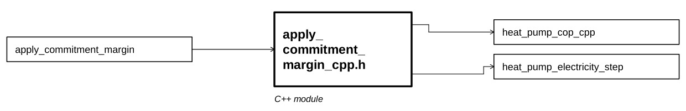

# apply_commitment_margin_cpp.h

**C++ module** &nbsp;·&nbsp; `30_Simulation/05_Models/01_Building/03_1_Functions_Cpp/apply_commitment_margin_cpp.h`

## Function

The compiled core of apply_commitment_margin(): one market slot at a time, it finds the deepest scaling of the itinerary whose electricity stays inside the bound of the slot, by bisection on the closed form of the electricity. The bound of every slot comes in already computed: it is the commitment band the system asks of the slot, set by commitment_margin_bound() from energy alone. This function is the side of the asset: it fits the heat of the itinerary into that band. The electricity of a row is the one heat_pump_electricity_step() computes, at the COP of heat_pump_cop_cpp(): the same electrical model the period simulation uses. It is a monotone, piecewise linear function of the heat of the row, so the electricity of the slot is monotone in the scaling factor and the bisection needs no simulation. The rules it applies, and why the margin exists, are described in apply_commitment_margin(), which prepares its inputs.
The file is a header, included by period_simulation_cpp.cpp, so that the single Rcpp::sourceCpp() call that compiles the simulation also compiles and exports this function.

## Called by

- [apply_commitment_margin.R](apply_commitment_margin.md)

## What it calls, in order of appearance

- [heat_pump_cop_cpp.h](heat_pump_cop_cpp.md)
- [heat_pump_electricity_step.h](heat_pump_electricity_step.md)

## Input data

- All the vectors are the same length, one entry per row of the Commitment Phase, and all the heat quantities are energies in kWh. Q_heat_flex         : NumericVector. Heating of the itinerary, before the margin. Q_heat_plan         : NumericVector. Heating of the plan. Q_cool_flex         : NumericVector. Cooling of the itinerary. Q_cool_plan         : NumericVector. Cooling of the plan. slot_id             : IntegerVector. The market slot of each row, numbered from 1. A row with 0 belongs to no slot and is left as it is. bound               : NumericVector, one entry per slot. The electricity (kWh) the itinerary of the slot may reach: at most this upward, at least this downward. Text                : NumericVector. Outdoor temperature (degC). delta_t_h           : NumericVector. Timestep (h). leg_up              : Boolean. True for the upward leg, false for the downward one. bisection_steps     : Integer. Number of halvings of the bisection (parameter flexibility_commitment_bisection_steps). COP_hp_heat_1_coef1, COP_hp_heat_1_coef2, COP_hp_heat_1_coef3, Tsup_hp_heat, Text_ref_hp_heat, Tsup_ref_hp_heat : Double. The COP of the heat pump, as heat_pump_cop_cpp() reads them. Q_hp_heat_1         : Double. First rated heating power (kW). COP_hp_cool         : Double. Cooling COP (dimensionless).

## Output data

- List with two NumericVectors the length of the inputs: Q_heat : heating of the itinerary after the margin Q_cool : cooling of the itinerary after the margin

## Other notes from the file header

### The sums of a slot

The electricity of a slot is added up in long double and the rows that are missing are left out, as R's sum(..., na.rm = TRUE) does, which is how commitment_margin_bound() adds up the bound. The total is then rounded to a double. A sum beyond the range of a double is returned as an infinity of the same sign.

### Code outline

1. Check the inputs, and the COP and the rows of every slot
2. One slot at a time, find the deepest factor that meets the rule
    - 2.1. The plan and the itinerary against the bound
    - 2.2. The bisection
3. Return the itinerary

### Usage instructions

From R, once period_simulation_cpp.cpp is compiled, through apply_commitment_margin().

## Diagram

Also available as [apply_commitment_margin_cpp.svg](apply_commitment_margin_cpp.svg).

---

[Back to the code structure index](../Code_Structure.md)
