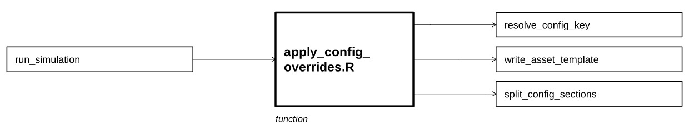

# apply_config_overrides.R

**Function** &nbsp;·&nbsp; `30_Simulation/03_Functions/apply_config_overrides.R`

## Function

Writes a copy of a configuration folder with some of its values changed. The overrides are applied to the files themselves, before anything is loaded, so the run that reads the copy validates every overridden value against the parameter catalogue, exactly as a value written in the original file. An invalid override is therefore rejected the same way as an invalid file. An override is either a plain parameter assignment on a parameter/value file, or an operation on a file.

## Called by

- [run_simulation.R](run_simulation.md)

## What it calls, in order of appearance

- [resolve_config_key.R](resolve_config_key.md)
- [write_asset_template.R](write_asset_template.md)
- [split_config_sections.R](split_config_sections.md)

## Input data

- config_path : Character. The configuration folder to copy. It is not modified.
- overrides   : Data frame with the text columns:
    - file      : the configuration file, as @<key> where <key> is a key of 00_Inner_parameters/04_File_paths.csv (for example @reward_file), as @<asset_id>/<key> for a file of an asset (for example @Building_001/model_file), or as a file name relative to config_path for a folder that has no such table
    - parameter : the parameter, or the operation, starting with "@"
    - value     : the new value, or the argument of the operation

The rows are applied in their order.

- target_path : Character. The folder the copy is written to. It must not exist yet.

## Output data

- Character. target_path, which holds the whole configuration folder with the overrides applied.

## Other notes from the file header

### The operations on a file

A table has no parameter/value shape, so a change to a table is declared as an operation on the file:

- @keep_rows: keeps only the rows whose first field is in the list given as value, separated by ";"
- @set_column:<column>: sets the column to the value in every row
- @clear: removes every row of the table

The table of a file that holds a block of parameters above it is the part below the blank line that closes the block: the operations never touch the block. A parameter assignment finds its parameter in the block as in any other file. Two more operations write a defect into a parameter/value file, so that the loading of a defective file can be tried:

- @duplicate: the parameter given as value is written twice
- @rename:<new name>: the parameter given as value is written with another name, as a misspelt name would be

### The operation that adds an asset

A new asset needs a row in the asset registry and a configuration folder, so it is declared as an operation on the registry:

- @add_asset: the file is the registry (@asset_registry_file) and the value is the id of the new asset, for example Building_002. The type of the asset is the id without its underscore and its three digits. The row is appended to the registry, and the folder of the asset is written with the default values, as for any new asset. The rows that follow, written for the new asset (for example @Building_002/model_file), change that folder.

The operation needs write_asset_template() and the functions it calls to be loaded (see its header).

### Code outline

0. Copy the configuration folder
1. Resolve the file keys
2. Add the assets
3. Separate parameter assignments from table operations
4. Apply the parameter assignments, one file at a time
5. Apply the table operations

### Usage instructions

```r
overrides <- data.frame(file      = "@Building_001/comfort_file",
  parameter = "alpha_comfort",
  value     = "0.5")
```

```r
apply_config_overrides(
  config_path = file.path("30_Simulation", "02_Config"),
  overrides   = overrides,
  target_path = tempfile("config_")
  )
```

### Exceptions and special cases

- The comment lines of a configuration file are preserved: the file is rewritten line by line, and only the value field of the overridden parameter changes.
- A file given as @<key> or @<asset_id>/<key> is looked up in the file paths table of the configuration folder. A key the table does not hold, a key given with the wrong kind of name, or a folder without the table, stops execution.
- @add_asset stops execution if the id is not a type followed by an underscore and three digits, or if the folder of the asset already exists. Its rows are applied before every other override, whatever their place in the table.
- An override on a parameter the file does not declare, or on a file the folder does not hold, stops execution. The copy made in target_path is then removed.

## Diagram



Also available as [apply_config_overrides.svg](apply_config_overrides.svg).

---

[Back to the code structure index](../Code_Structure.md)
