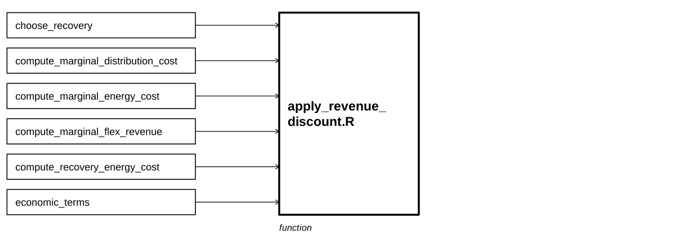

# apply_revenue_discount.R

**Function** &nbsp;·&nbsp; `30_Simulation/03_Functions/apply_revenue_discount.R`

## Function

Applies the revenue discount factor to a per-interval economic result, discounting income and leaving expense untouched.
Why income and expense are treated differently The discount expresses caution about what the building expects to EARN far into the future, not about what it expects to spend. A cost is committed as certainly as any other, so discounting it would make distant operation look cheaper than it is and would invite the optimizer to push expense towards the end of the horizon, which is the opposite of prudence. Under the repository's sign convention (positive = income, negative = expense - see calc_differential_cost()) that rule reads directly off the sign of each interval's own result.

The sign is read per interval, not on the total Each market interval carries its own cash flow and its own distance from the decision instant, so each one is classified and discounted on its own. Netting the horizon first and then classifying would let a distant income be hidden inside a near expense, and the discount would depend on the aggregation rather than on the money itself.

## Called by

- [choose_recovery.R](choose_recovery.md)
- [compute_marginal_distribution_cost.R](compute_marginal_distribution_cost.md)
- [compute_marginal_energy_cost.R](compute_marginal_energy_cost.md)
- [compute_marginal_flex_revenue.R](compute_marginal_flex_revenue.md)
- [compute_recovery_energy_cost.R](compute_recovery_energy_cost.md)
- [economic_terms.R](economic_terms.md)

## What it calls, in order of appearance

- Nothing: this piece calls no other piece of the project.

## Input data

- value_by_interval    : Numeric vector. Economic result per interval, in EUR, already carrying the repository's sign (positive = income, negative = expense).
- discount_by_interval : Numeric vector, same length. Discount factor of each interval, as returned by revenue_discount_factor().

## Output data

- Numeric vector, same length as value_by_interval. Each positive entry multiplied by its own factor; each non-positive entry unchanged.

## Other notes from the file header

### Code outline

1. Discount the positive entries only

### Usage instructions

```r
discounted <- apply_revenue_discount(cost_by_market, discount_by_market)
```

### Exceptions and special cases

- A zero entry is left as it is: it is neither income nor expense, and discounting it would change nothing anyway.
- The distribution cost is negative in every interval by construction, so this function is a no-op there. It is still applied, so that a future term of either sign is weighted by the same rule without anyone having to remember to add it.

## Diagram



Also available as [apply_revenue_discount.svg](apply_revenue_discount.svg).

---

[Back to the code structure index](../Code_Structure.md)
