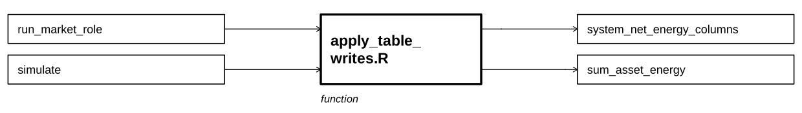

# apply_table_writes.R

**Function** &nbsp;·&nbsp; `30_Simulation/03_Functions/apply_table_writes.R`

## Function

Applies a list of writes, in order, to the table that holds each column: a column of the asset goes to the table of the asset, assets[[asset_id]]$df, and any other column to Main_df. When a write changes the net electricity of the asset in an itinerary (system_net_energy_columns()), the column of the same name of Main_df, the net electricity of the system, is written again on the same rows as the sum over the assets (sum_asset_energy()). So the energy of the system is always the sum of the energy of its assets. With asset_id NULL the writes are all of the system: every one goes to Main_df, and a column that the table of an asset holds is not written there, so the net electricity of the system is only ever written as the sum of that of the assets. Every write goes through data.table::set(), which writes into the existing columns of the table, so neither table is copied.

## Called by

- [run_market_role.R](run_market_role.md)
- [simulate.R](simulate.md)

## What it calls, in order of appearance

- [system_net_energy_columns.R](system_net_energy_columns.md)
- [sum_asset_energy.R](sum_asset_energy.md)

## Input data

- writes   : List of writes, each a list with:
    - column : Character scalar. The column written.
    - rows   : Integer vector. The rows written.
    - value  : Vector, one value per row.
    - mode   : "assign" to replace the values, or "add" to add value to them.
- Main_df  : Data table. The common and system columns.
- assets   : Named list, one entry per asset, each with df, the table of the asset (a data table).
- asset_id : Character scalar. The asset the writes of asset columns belong to. NULL for a list of writes of the system only.

## Output data

- Named list with Main_df and assets, written in place.

## Other notes from the file header

### Code outline

1. The columns of the asset and of every asset
2. Apply each write to its table, and the sum of the assets to Main_df

### Usage instructions

```r
tables <- apply_table_writes(
  writes   = itinerary_writes,
  Main_df  = Main_df,
  assets   = assets,
  asset_id = asset_id
  )
```

Main_df <- tables$Main_df assets  <- tables$assets

```r
tables <- apply_table_writes(
  writes   = system_writes,
  Main_df  = Main_df,
  assets   = assets,
  asset_id = NULL
  )
```

### Exceptions and special cases

- A write to a column that neither table holds stops the run.
- The key time is never written.
- With asset_id NULL, a write to a column held by the table of any asset stops the run: those writes need the asset_id.

## Diagram



Also available as [apply_table_writes.svg](apply_table_writes.svg).

---

[Back to the code structure index](../Code_Structure.md)
