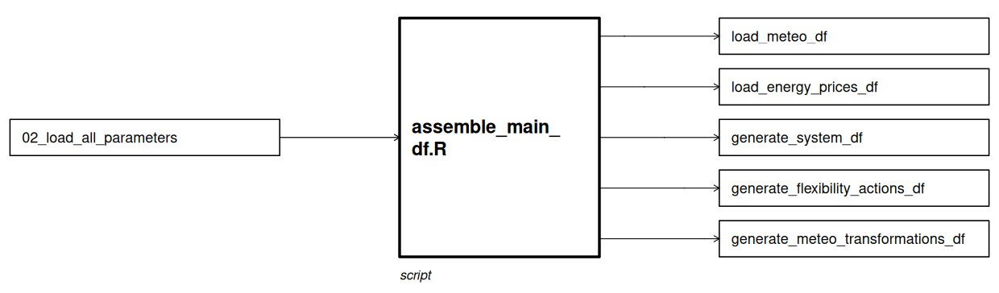

# assemble_main_df.R

**Script** &nbsp;·&nbsp; `30_Simulation/04_Scripts/assemble_main_df.R`

## Function

Replaces the previous "Main_df <- readRDS(paths$main_file)" step. Loads the 2 real input dataframes:

- Meteo_df
- Energy_Prices_df

and generates the 3 synthetic dataframes:

- System_df
- Flexibility_actions_df
- Meteo_transformations_df

on a common master grid, then assembles them into a single Main_df - exactly the interface the rest of the codebase expects.

## Called by

- [02_load_all_parameters.R](02_load_all_parameters.md)

## What it calls, in order of appearance

- [load_meteo_df.R](load_meteo_df.md)
- [load_energy_prices_df.R](load_energy_prices_df.md)
- [generate_system_df.R](generate_system_df.md)
- [generate_flexibility_actions_df.R](generate_flexibility_actions_df.md)
- [generate_meteo_transformations_df.R](generate_meteo_transformations_df.md)

## Input data

- paths      : List, set by 01_initialization.R. Must contain:
    - meteo_file
    - meteo_validation_file
    - energy_prices_file
    - energy_prices_validation_file
    - system_variables_file
- parameters : List. Must contain parameters$computing, already loaded by load_01_computing_parameters.R, whose main_resolution_sec defines the master grid built here.

## Output data

- Main_df : Data frame on the master grid, with the columns of:
    - time (POSIXct, master grid)
    - Meteo_df (interpolated)
    - Energy_Prices_df (step-held)
    - System_df
    - Flexibility_actions_df
    - Meteo_transformations_df

The last three are generated directly on the master grid.

## Other notes from the file header

### Code outline

1. Load and validate Meteo_df, Energy_Prices_df
2. Determine the common time range (start strict, end trimmed with warning) and build the master grid
3. Interpolate Meteo_df onto the master grid
4. Step-hold Energy_Prices_df onto the master grid
5. Generate System_df, Flexibility_actions_df, Meteo_transformations_df
6. Assemble Main_df

### Usage instructions

```r
source(file.path("30_Simulation", "04_Scripts", "assemble_main_df.R"))
```

Not called: sourced by 02_load_all_parameters.R, once the configuration is loaded and before Main_df is validated.

### Exceptions and special cases

- If Meteo_df$time and Energy_Prices_df$time do not start at exactly the same instant, stop() (no permissive fallback for the start of the series).
- If one series ends later than the other, the longer one is trimmed to the shorter one's end, and warning() reports how many rows were discarded and from which file.

## Diagram



Also available as [assemble_main_df.svg](assemble_main_df.svg).

---

[Back to the code structure index](../Code_Structure.md)
