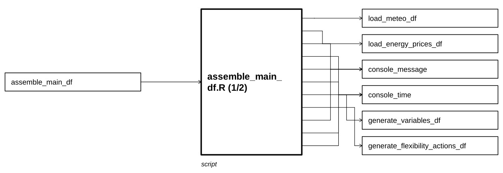

# assemble_main_df.R &mdash; Called items, block 1 of 2

Block 1 of 2 of [assemble_main_df.R](assemble_main_df.md).

## What it calls, in this block

- [load_meteo_df.R](load_meteo_df.md)
- [load_energy_prices_df.R](load_energy_prices_df.md)
- [console_message.R](console_message.md)
- [console_time.R](console_time.md)
- [generate_variables_df.R](generate_variables_df.md)
- [generate_flexibility_actions_df.R](generate_flexibility_actions_df.md)

## Diagram

Also available as [assemble_main_df__1.svg](assemble_main_df__1.svg).

---

[Back to assemble_main_df.R](assemble_main_df.md) &nbsp;·&nbsp; [Back to the code structure index](../Code_Structure.md)
