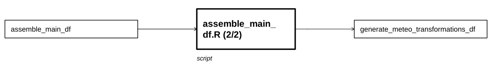

# assemble_main_df.R &mdash; Called items, block 2 of 2

Block 2 of 2 of [assemble_main_df.R](assemble_main_df.md).

## What it calls, in this block

- [generate_meteo_transformations_df.R](generate_meteo_transformations_df.md)

## Diagram

Also available as [assemble_main_df__2.svg](assemble_main_df__2.svg).

---

[Back to assemble_main_df.R](assemble_main_df.md) &nbsp;·&nbsp; [Back to the code structure index](../Code_Structure.md)
