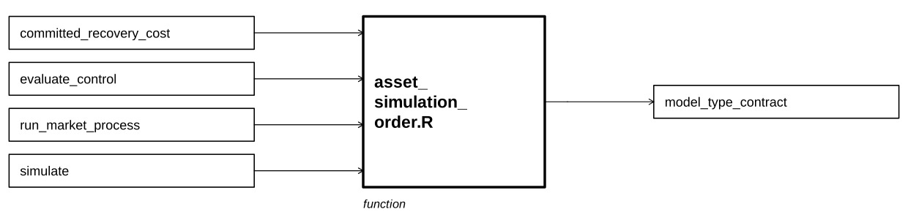

# asset_simulation_order.R

**Function** &nbsp;·&nbsp; `30_Simulation/03_Functions/asset_simulation_order.R`

## Function

Gives the order in which the assets of the registry are simulated over a plan or a step of the execution. An asset whose type reads the net electricity of the rest of the system (the operation reads_rest_net of its contract, see model_type_contract()) needs the electricity of the other assets before it is simulated. So the assets that do not read it come first, in the order of the registry, and the assets that read it come after them, also in the order of the registry. With no asset that reads it, the order is that of the registry.

## Called by

- [committed_recovery_cost.R](committed_recovery_cost.md)
- [evaluate_control.R](evaluate_control.md)
- [run_market_process.R](run_market_process.md)
- [simulate.R](simulate.md)

## What it calls, in order of appearance

- [model_type_contract.R](model_type_contract.md)

## Input data

- parameters : Named list. The parameters of the simulation, with assets, one entry per asset of the registry in its order, each one with its asset_type.

## Output data

- Character vector. The asset_id of every asset, in the order of simulation.

## Other notes from the file header

### Code outline

1. Split the assets by what they read
2. Give the order

### Usage instructions

for (CONT_001 in asset_simulation_order(parameters)) {

- asset <- parameters$assets[[CONT_001]]

}

## Diagram

Also available as [asset_simulation_order.svg](asset_simulation_order.svg).

---

[Back to the code structure index](../Code_Structure.md)
