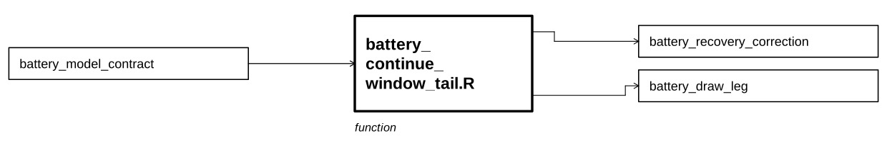

# battery_continue_window_tail.R

**Function** &nbsp;·&nbsp; `30_Simulation/05_Models/03_Battery/03_Functions/battery_continue_window_tail.R`

## Function

Continues, over the plan of a chunk, the tail of a flexibility window of a battery whose Commitment Phase ended before the chunk starts. Only its Neutral and Recovery Phases are left. It is the operation continue_window_tail of the type of model Battery (model_type_contract()). The window left the leg of the battery with some energy on row 1, the state of the tail, which the caller has written there. On the rows of the tail, the leg follows the electricity of the plan, b (kWh of the system side, positive to charge), from that energy. The leg is carried out when no step from row 2 to the close of the control horizon breaks a limit of the battery (battery_free_trajectory()). If it is not, the battery corrects its Recovery Phase as for a window it draws (battery_recovery_correction()): one power over the rows of phase 3 of the tail, or what a row can still take if it is less, in the direction that gives the energy back, until the leg is back on the energy of the plan, where the correction stops. A tail cannot be refused, so when no correction carries the leg out the battery takes the largest one it can make. The correction is the one the tail asks (tail$recovery, minimum or plan). Without it, or with minimum, it is the least that carries the leg out. With plan, the battery buys or sells until it is back on the energy of the plan at the last row of the Recovery Phase, or as far as its power allows, never less than the least correction. The leg is drawn from row 2 to the last row of the tail, and its stored energy keeps on the rows after it the difference the tail left (battery_draw_leg()). The phases of the tail are of the system, so the battery marks none.

## Called by

- [battery_model_contract.R](battery_model_contract.md)

## What it calls, in order of appearance

- [battery_recovery_correction.R](battery_recovery_correction.md)
- [battery_draw_leg.R](battery_draw_leg.md)

## Input data

- period_chunk : Data frame. The view of the battery of the piece being derived, with both flexibility itineraries laid as a copy of the plan, and the state of the tail written on row 1 of Stored_energy_plan_flex_<leg>. Reads time and, for the leg, Elec_charge_plan_flex_<leg>, Elec_discharge_plan_flex_<leg> and Stored_energy_plan_flex_<leg>.
- leg          : Character scalar, "down" or "up".
- tail         : Named list, the view of this battery of the tail: rows            - Integer vector. Rows of the chunk occupied by the tail. phases          - Integer vector, one per row of rows: 2 Neutral, 3 Recovery. i_end_control   - Integer. The row where the control horizon closes. bisection_steps - Integer. The halvings of each bisection of the correction. tolerance       - Numeric. The tolerance of the comparisons with the limits (kWh). recovery        - minimum or plan; absent or NULL for minimum. The state and the system of the tail are not read: the state is already on row 1.
- asset        : Named list. The parameters of the battery, its entry of parameters$assets.

## Output data

- Data frame. The view with the leg of the battery drawn over the rows of the tail, and the stored energy of the rows after them moved by the difference.

## Other notes from the file header

### Code outline

1. Read the tail
2. The correction of the Recovery Phase
3. Draw the leg

### Usage instructions

```r
view <- battery_continue_window_tail(
  period_chunk = view,
  leg          = "down",
  tail         = list(rows = 2:5, phases = c(2L, 2L, 3L, 3L),
  i_end_control = 8, bisection_steps = 24,
  tolerance = 1e-9, recovery = NULL),
  asset        = asset
  )
```

## Diagram



Also available as [battery_continue_window_tail.svg](battery_continue_window_tail.svg).

---

[Back to the code structure index](../Code_Structure.md)
