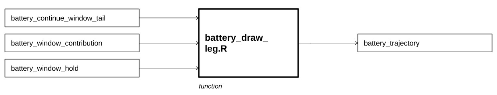

# battery_draw_leg.R

**Function** &nbsp;·&nbsp; `30_Simulation/05_Models/03_Battery/03_Functions/battery_draw_leg.R`

## Function

Draws the itinerary of a flexibility leg of a battery over a run of consecutive rows, from the energy each row asks of it, and carries the difference that this leaves in the stored energy to the rows after the run. The run starts from the energy that the leg holds in the row before it. battery_trajectory() computes the electricity and the energy of each row of the run within the limits of the battery, and they are written in the columns of the leg: Elec_charge, Elec_discharge, Elec_total and Stored_energy. The rows after the run keep their electricity: the leg follows the energy it had. Their stored energy changes by the difference the run left in its last row, kept only in the share that the self-discharge leaves from row to row. No limit is checked on those rows: the caller checks the ones that matter.

## Called by

- [battery_continue_window_tail.R](battery_continue_window_tail.md)
- [battery_window_contribution.R](battery_window_contribution.md)
- [battery_window_hold.R](battery_window_hold.md)

## What it calls, in order of appearance

- [battery_trajectory.R](battery_trajectory.md)

## Input data

- period_chunk   : Data frame. The view of the battery, with the columns time and, for the leg, Elec_charge_plan_flex_<leg>, Elec_discharge_plan_flex_<leg>, Elec_total_plan_flex_<leg> and Stored_energy_plan_flex_<leg>.
- leg            : Character scalar. down or up.
- rows           : Integer vector. The rows of the run, consecutive and from row 2 on: the row before the first one holds its initial condition.
- energy_request : Numeric vector, as long as rows. The energy each row asks of the battery (kWh of the system side, positive to charge). It may be Inf or -Inf.
- asset          : Named list. The parameters of the battery, its entry of parameters$assets.

## Output data

- Data frame. The chunk with the leg drawn over the rows and the stored energy of the rows after them moved by the difference.
- The run stops if the rows are not valid.

## Other notes from the file header

### Code outline

1. Check the rows
2. Draw the run
3. Carry the difference to the following rows

### Usage instructions

```r
period_chunk <- battery_draw_leg(
  period_chunk   = period_chunk,
  leg            = "down",
  rows           = 5:8,
  energy_request = rep(-1, 4),
  asset          = asset
  )
```

## Diagram



Also available as [battery_draw_leg.svg](battery_draw_leg.svg).

---

[Back to the code structure index](../Code_Structure.md)
