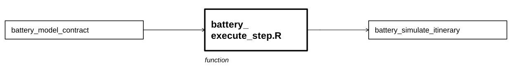

# battery_execute_step.R

**Function** &nbsp;·&nbsp; `30_Simulation/05_Models/03_Battery/03_Functions/battery_execute_step.R`

## Function

Runs a battery over a step of the simulation. It is the operation execute_step of the contract of the type Battery (see model_type_contract()). The step is what the battery stores, takes and gives over the rows of the chunk, in the calculation context: "execution" for the step that the simulation really runs, with the mode of the plan and the net electricity that the rest of the system has had, and "plan" for the rows between the last executed one and the start of the optimization. It is the asset side of the step, like the one of any other type: it writes no money and no column of the system.

## Called by

- [battery_model_contract.R](battery_model_contract.md)

## What it calls, in order of appearance

- [battery_simulate_itinerary.R](battery_simulate_itinerary.md)

## Input data

- period_chunk        : Data frame. The rows of the step, with the columns of the battery of the context.
- simulation_control  : Named list. Not read.
- timestamps          : Named list. Not read.
- parameters          : Named list. Not read.
- asset               : Named list. The parameters of the battery, its entry of parameters$assets.
- calculation_context : Character. "execution" or "plan".
- Every operation execute_step of the contract receives the same arguments (see model_type_contract()).

## Output data

- Data frame. period_chunk with the step of the battery written.

## Other notes from the file header

### Code outline

1. Run the step of the battery

### Usage instructions

```r
period_chunk <- battery_execute_step(
  period_chunk        = period_chunk,
  simulation_control  = simulation_control,
  timestamps          = timestamps,
  parameters          = parameters,
  asset               = asset,
  calculation_context = "execution"
  )
```

## Diagram



Also available as [battery_execute_step.svg](battery_execute_step.svg).

---

[Back to the code structure index](../Code_Structure.md)
