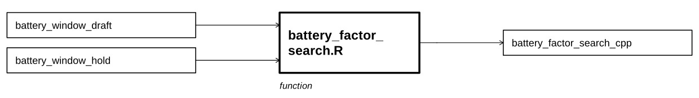

# battery_factor_search.R

**Function** &nbsp;·&nbsp; `30_Simulation/05_Models/03_Battery/03_Functions/battery_factor_search.R`

## Function

Finds the largest factor between 0 and 1 with which a leg of a battery can be carried out over a stretch of steps. It is the factor of the battery in the draft of a flexibility window (battery_window_draft()), and the factor of what it holds of a window already sold (battery_window_hold()). The request of a factor f is the base request, with

- base_request[k] + f * factor_energy[j]

on each step k = factor_steps[j]. The leg is carried out with f:

- without the Recovery Phase, when no step of the stretch breaks a limit of the battery, as battery_free_trajectory() finds;
- with the Recovery Phase, when the least correction of the Recovery Phase carries the whole stretch out, as battery_recovery_correction() finds it with every step checked and no target energy. The correction never takes the leg past the energy it stored before the window, reference_energy.

If the factor 1 carries the leg out, it is 1. If not even the factor 0 does, nothing is found. Otherwise a bisection keeps the factor that carries it out, and the factor is the lower end of the last interval. This function checks the inputs. The search is made in compiled code, by battery_factor_search_cpp(), which tests every factor with the same physics as the R functions above, with the same operations in the same order.

## Called by

- [battery_window_draft.R](battery_window_draft.md)
- [battery_window_hold.R](battery_window_hold.md)

## What it calls, in order of appearance

- [battery_factor_search_cpp.h](battery_factor_search_cpp.md)

## Input data

- stored_energy_start : Numeric scalar. The energy stored before the first step (kWh).
- delta_t_h           : Numeric vector. The duration of each step of the stretch (h).
- base_request        : Numeric vector, as long as delta_t_h. The request of each step with the factor 0 (kWh of the system side, positive to charge).
- reference_energy    : Numeric vector, as long as delta_t_h. The energy the leg stored at the end of each step before the window (kWh). It is read only with the Recovery Phase.
- factor_steps        : Integer vector. The steps the factor moves, positions in the stretch.
- factor_energy       : Numeric vector, as long as factor_steps. The energy the factor 1 adds to each of those steps (kWh).
- with_recovery       : Logical scalar. TRUE to carry the leg out with the least correction of the Recovery Phase.
- recovery_steps      : Integer vector. The steps of the Recovery Phase, positions in the stretch. It may be empty, and it is read only with the Recovery Phase.
- direction           : Numeric scalar, 1 to charge in the Recovery Phase and -1 to discharge.
- battery             : Named list. The parameters of the battery (asset$battery).
- bisection_steps     : Integer scalar. The halvings of each bisection.
- tolerance           : Numeric scalar. The tolerance of the comparisons with the limits (kWh).

## Output data

- Named list with:
    - found: logical. FALSE when not even the factor 0 carries the leg out.
    - factor: numeric. The factor found, 0 when nothing is found.
- The run stops if an input is missing, the vectors differ in length, a step is outside the stretch or the direction is not 1 or -1.

## Other notes from the file header

### Code outline

1. Check the inputs
2. Find the factor

### Usage instructions

```r
search <- battery_factor_search(
  stored_energy_start = 3,
  delta_t_h           = rep(0.25, 8),
  base_request        = rep(0, 8),
  reference_energy    = rep(3, 8),
  factor_steps        = 2:3,
  factor_energy       = c(-1, -1),
  with_recovery       = TRUE,
  recovery_steps      = 5:6,
  direction           = 1,
  battery             = asset$battery,
  bisection_steps     = 24,
  tolerance           = 1e-9
  )
```

## Diagram



Also available as [battery_factor_search.svg](battery_factor_search.svg).

---

[Back to the code structure index](../Code_Structure.md)
