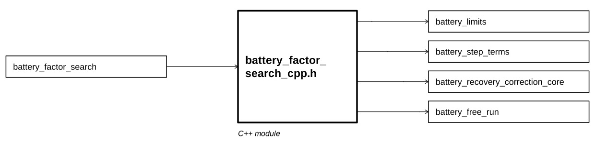

# battery_factor_search_cpp.h

**C++ module** &nbsp;·&nbsp; `30_Simulation/05_Models/03_Battery/03_1_Functions_Cpp/battery_factor_search_cpp.h`

## Function

Finds, for R, the largest factor between 0 and 1 with which a leg of a battery can be carried out over a stretch of steps. It is the factor of the battery in the draft of a flexibility window, and the factor of what it holds of a window already sold. The request of a factor f is the base request, with

- base_request[k] + f * factor_energy[j]

on each step k = factor_steps[j]. The leg is carried out with f:

- without the Recovery Phase, when no step of the stretch breaks a limit of the battery (battery_free_run());
- with the Recovery Phase, when the least correction of the Recovery Phase carries the whole stretch out (battery_recovery_correction_core(), with every step checked and no target energy). The correction never takes the leg past the energy it stored before the window.

If the factor 1 carries the leg out, it is 1. If not even the factor 0 does, nothing is found. Otherwise a bisection of bisection_steps halvings keeps the factor that carries it out, and the factor is the lower end of the last interval. The parameters and the terms of each step are computed once for the whole search. The operations are those of R, in the same order. The file is a header, included by battery_trajectory_cpp.cpp, so that the single Rcpp::sourceCpp() call that compiles the module also compiles and exports this function. R calls it through battery_factor_search(), which checks the inputs first.

## Called by

- [battery_factor_search.R](battery_factor_search.md)

## What it calls, in order of appearance

- [battery_limits.h](battery_limits.md)
- [battery_step_terms.h](battery_step_terms.md)
- [battery_recovery_correction_core.h](battery_recovery_correction_core.md)
- [battery_free_run.h](battery_free_run.md)

## Input data

- stored_energy_start : Double. The energy stored before the first step (kWh).
- delta_t_h           : Rcpp::NumericVector. The duration of each step of the stretch (h).
- base_request        : Rcpp::NumericVector, as long as delta_t_h. The request of each step with the factor 0 (kWh of the system side, positive to charge).
- reference_energy    : Rcpp::NumericVector, as long as delta_t_h. The energy the leg stored at the end of each step before the window (kWh), which the correction of the Recovery Phase never passes. Read only with the Recovery Phase.
- factor_steps        : Rcpp::IntegerVector. The steps the factor moves, positions in the stretch from 1.
- factor_energy       : Rcpp::NumericVector, as long as factor_steps. The energy the factor 1 adds to each of those steps (kWh).
- with_recovery       : Bool. True to carry the leg out with the least correction of the Recovery Phase.
- recovery_steps      : Rcpp::IntegerVector. The steps of the Recovery Phase, positions from 1. Read only with the Recovery Phase; it may be empty.
- direction           : Double, 1 to charge in the Recovery Phase and -1 to discharge. Read only with the Recovery Phase.
- battery             : Rcpp::List. The parameters of the battery (asset$battery).
- bisection_steps     : Integer. The halvings of each bisection.
- tolerance           : Double. The tolerance of the comparisons with the limits (kWh).

## Output data

- Rcpp::List with:
    - found: logical. FALSE when not even the factor 0 carries the leg out.
    - factor: numeric. The factor found, 0 when nothing is found.
- It stops with an error if the vectors differ in length or a position is outside the stretch.

## Other notes from the file header

### Code outline

1. Check the inputs and compute the terms of each step
2. The test of a factor
3. The search of the factor

### Usage instructions

From R, once battery_trajectory_cpp.cpp is compiled, through battery_factor_search():

```r
search <- battery_factor_search_cpp(
  3, rep(0.25, 8), rep(0, 8), rep(3, 8), 2:3, c(-1, -1), TRUE, 5:6,
  1, asset$battery, 24L, 1e-9)
```

## Diagram



Also available as [battery_factor_search_cpp.svg](battery_factor_search_cpp.svg).

---

[Back to the code structure index](../Code_Structure.md)
