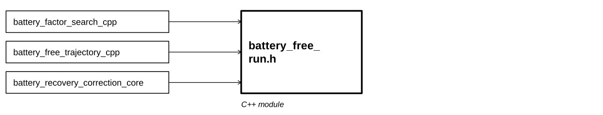

# battery_free_run.h

**C++ module** &nbsp;·&nbsp; `30_Simulation/05_Models/03_Battery/03_1_Functions_Cpp/battery_free_run.h`

## Function

Computes the energy a battery would store over a run of steps if nothing limited it, and says on which steps the request breaks a limit of the battery. It is the only copy of that physics in the compiled code: the free trajectory that R calls, the least correction of the Recovery Phase and the search of the factor of a leg all run it. With E_0 the energy before the first step, eta_c and eta_d the efficiencies, R_k the request of the step k and F_k the share kept from the start to the end of the step k (battery_step_terms()):

1. in_k = eta_c * max(R_k, 0) - max(-R_k, 0) / eta_d The energy that enters the battery (kWh).
2. E_k  = F_k * (E_0 + sum, for j up to k, of in_j / F_j) The energy stored at the end of the step (kWh).

The sum is accumulated in long double and rounded at every step, as the cumulative sum of R, so that the energy is exactly the one that R computes with cumsum() and cumprod(). A step breaks the lower side when it discharges and either the energy falls below E_min or the electricity it gives is above P_d times the duration of the step. It breaks the upper side when it charges and either the energy rises above E_max or the electricity it takes is above P_c times the duration of the step. All the comparisons have a tolerance. The file is a header, included by battery_trajectory_cpp.cpp. It is not callable from R.

## Called by

- [battery_factor_search_cpp.h](battery_factor_search_cpp.md)
- [battery_free_trajectory_cpp.h](battery_free_trajectory_cpp.md)
- [battery_recovery_correction_core.h](battery_recovery_correction_core.md)

## What it calls, in order of appearance

- Nothing: this piece calls no other piece of the project.

## Input data

- stored_energy_start : Double. The energy stored before the first step (kWh).
- energy_request      : std::vector<double>. The request of each step (kWh of the system side, positive to charge).
- limits              : BatteryLimits. The limits of the battery (battery_limits()).
- steps               : BatterySteps. The terms of each step (battery_step_terms()).
- tolerance           : Double. The tolerance of the comparisons with the limits (kWh).
- run                 : BatteryFreeRun. Written: its vectors are resized to the run and filled.

## Output data

- None returned. The run is written into run.

## Other notes from the file header

### The structure BatteryFreeRun

stored_energy : std::vector<double>. The energy stored at the

- end of each step (kWh).

breach_low    : std::vector<char>. 1 on the steps that break a

- limit while discharging.

breach_high   : std::vector<char>. 1 on the steps that break a

- limit while charging.

### Code outline

1. Run the steps

### Usage instructions

From C++, after including this header:

- BatteryFreeRun run;
- battery_free_run(stored_energy_start, request, limits, steps, tolerance, run);

## Diagram

Also available as [battery_free_run.svg](battery_free_run.svg).

---

[Back to the code structure index](../Code_Structure.md)
