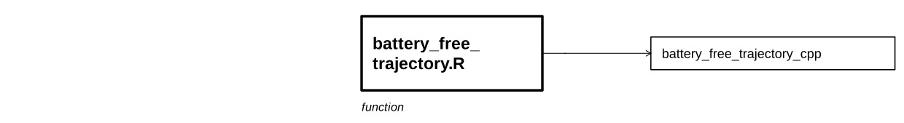

# battery_free_trajectory.R

**Function** &nbsp;·&nbsp; `30_Simulation/05_Models/03_Battery/03_Functions/battery_free_trajectory.R`

## Function

Computes the energy a battery would store over a run of steps if nothing limited it, and says on which steps the request breaks a limit of the battery. It is the test the flexibility windows use to decide whether a request can be carried out: it does not clip the request, as battery_trajectory() does, it reports where the request could not be served. While no step breaks a limit it gives the same energy as battery_trajectory(), up to the rounding. With the same symbols as battery_trajectory(), in each step k:

1. in_k   <- eta_c * max(R_k, 0) - max(-R_k, 0) / eta_d The energy that enters the battery (kWh).
2. F_k    <- product, for j up to k, of f_j, with f_j <- (1 - s)^(dt_j / 24), the share of the energy that the battery keeps in the step j.
3. E_k    <- F_k * (E_0 + sum, for j up to k, of in_j / F_j) The energy stored at the end of the step (kWh).

A step breaks the lower side when it discharges and either the energy falls below E_min or the electricity it gives is above P_d times the duration of the step. It breaks the upper side when it charges and either the energy rises above E_max or the electricity it takes is above P_c times the duration of the step. All the comparisons have a tolerance. This function checks the inputs. The run is computed in compiled code, by battery_free_trajectory_cpp(), with the same operations in the same order. The sum and the product are accumulated as R accumulates cumsum() and cumprod().

## Called by

- Nothing calls it: this is the entry point of the simulation.

## What it calls, in order of appearance

- [battery_free_trajectory_cpp.h](battery_free_trajectory_cpp.md)

## Input data

- stored_energy_start : Numeric scalar. The energy stored before the first step (kWh).
- delta_t_h           : Numeric vector. The duration of each step (h).
- energy_request      : Numeric vector, as long as delta_t_h. The request of each step (kWh of the system side, positive to charge).
- battery             : Named list. The parameters of the battery (asset$battery).
- tolerance           : Numeric scalar. The tolerance of the comparisons with the limits (kWh).

## Output data

- Named list of vectors as long as delta_t_h:
    - stored_energy: numeric, the energy stored at the end of each step (kWh).
    - breach: logical, TRUE on the steps that break a limit.
    - breach_low: logical, TRUE on the steps that break a limit while discharging.
    - breach_high: logical, TRUE on the steps that break a limit while charging.
- breach is breach_low or breach_high. The run stops if an input is missing or the vectors differ in length.

## Other notes from the file header

### Code outline

1. Check the inputs
2. Run the steps

### Usage instructions

```r
free <- battery_free_trajectory(
  stored_energy_start = 5,
  delta_t_h           = rep(0.25, 4),
  energy_request      = c(1, 1, -1, -1),
  battery             = asset$battery,
  tolerance           = parameters$computing$flex_energy_tol
  )
```

## Diagram



Also available as [battery_free_trajectory.svg](battery_free_trajectory.svg).

---

[Back to the code structure index](../Code_Structure.md)
