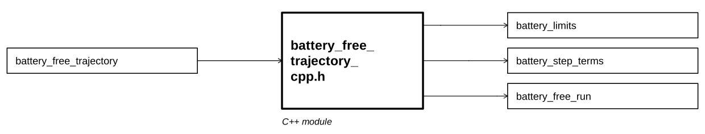

# battery_free_trajectory_cpp.h

**C++ module** &nbsp;·&nbsp; `30_Simulation/05_Models/03_Battery/03_1_Functions_Cpp/battery_free_trajectory_cpp.h`

## Function

Computes, for R, the energy a battery would store over a run of steps if nothing limited it, and says on which steps the request breaks a limit of the battery. The physics is that of battery_free_run(); this function reads the parameters, computes the terms of each step and returns the run as R vectors. R calls it through battery_free_trajectory(), which checks the inputs first. The file is a header, included by battery_trajectory_cpp.cpp, so that the single Rcpp::sourceCpp() call that compiles the module also compiles and exports this function.

## Called by

- [battery_free_trajectory.R](battery_free_trajectory.md)

## What it calls, in order of appearance

- [battery_limits.h](battery_limits.md)
- [battery_step_terms.h](battery_step_terms.md)
- [battery_free_run.h](battery_free_run.md)

## Input data

- stored_energy_start : Double. The energy stored before the first step (kWh).
- delta_t_h           : Rcpp::NumericVector. The duration of each step (h).
- energy_request      : Rcpp::NumericVector, as long as delta_t_h. The request of each step (kWh of the system side, positive to charge).
- battery             : Rcpp::List. The parameters of the battery (asset$battery).
- tolerance           : Double. The tolerance of the comparisons with the limits (kWh).

## Output data

- Rcpp::List with the vectors, as long as delta_t_h:
    - stored_energy: numeric, the energy stored at the end of each step (kWh).
    - breach: logical, TRUE on the steps that break a limit.
    - breach_low: logical, TRUE on the steps that break a limit while discharging.
    - breach_high: logical, TRUE on the steps that break a limit while charging.
- It stops with an error if the vectors differ in length.

## Other notes from the file header

### Code outline

1. Check the lengths and compute the terms of each step
2. Run the steps
3. Return the run

### Usage instructions

From R, once battery_trajectory_cpp.cpp is compiled, through battery_free_trajectory():

```r
free <- battery_free_trajectory_cpp(5, rep(0.25, 4),
  c(1, 1, -1, -1),
  asset$battery, 1e-9)
```

## Diagram



Also available as [battery_free_trajectory_cpp.svg](battery_free_trajectory_cpp.svg).

---

[Back to the code structure index](../Code_Structure.md)
