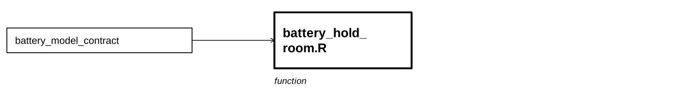

# battery_hold_room.R

**Function** &nbsp;·&nbsp; `30_Simulation/05_Models/03_Battery/03_Functions/battery_hold_room.R`

## Function

Gives the most electricity a battery can hold, on each row, of a flexibility window already sold that it does not redraw. It is the operation hold_room of the type of model Battery (model_type_contract()). The system uses it to share what a window misses among the assets that hold it (system_hold_window()). The room is by row, with no effect of one row on the next: it is the distance, on that row, between the electricity the leg of the battery has and the most the battery can discharge there (downward), or the most it can charge (upward). With E the energy the leg stores before the row, and f the share the battery keeps of it in the row (its self-discharge), the energy the row starts from is f * E. Downward, the most the battery discharges is the smaller of its discharge power times the duration of the row and the energy above its minimum that reaches the system (times its discharge efficiency). Upward, it is the smaller of its charge power times the duration of the row and the room under its maximum energy (divided by its charge efficiency). The room is that amount minus the electricity the leg already has on the row, never below 0.

## Called by

- [battery_model_contract.R](battery_model_contract.md)

## What it calls, in order of appearance

- Nothing: this piece calls no other piece of the project.

## Input data

- period_chunk : Data frame. The view of the battery, with the columns time and, for the itinerary of the leg, Elec_charge_plan_flex_<leg>, Elec_discharge_plan_flex_<leg> and Stored_energy_plan_flex_<leg>.
- leg          : Character scalar, "down" or "up".
- window_rows  : Integer vector. The rows of the window held, from row 2 on.
- parameters   : Named list. Not read.
- asset        : Named list. The parameters of the battery, its entry of parameters$assets.

## Output data

- Numeric vector (kWh), not negative, one value per row of window_rows.

## Other notes from the file header

### Code outline

1. Check the inputs
2. The room of each row

### Usage instructions

```r
room <- battery_hold_room(period_chunk = view,
  leg          = "down",
  window_rows  = 2:5,
  parameters   = parameters,
  asset        = asset)
```

## Diagram



Also available as [battery_hold_room.svg](battery_hold_room.svg).

---

[Back to the code structure index](../Code_Structure.md)
