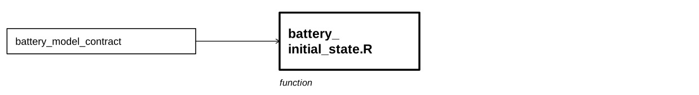

# battery_initial_state.R

**Function** &nbsp;·&nbsp; `30_Simulation/05_Models/03_Battery/03_Functions/battery_initial_state.R`

## Function

Operation initial_state of the type of model Battery: writes the energy the battery stores at the start of the simulation into row 1 of its table. Row 1 is the only true initial condition of the whole run: the simulation loop never recomputes it, in any context. The four contexts (exec, plan, plan_flex_down and plan_flex_up) are seeded with the same energy, SOC_initial * Capacity (kWh).

## Called by

- [battery_model_contract.R](battery_model_contract.md)

## What it calls, in order of appearance

- Nothing: this piece calls no other piece of the project.

## Input data

- asset_df  : data.table. The table of the battery, with the columns Stored_energy_* of the four contexts. It is changed by reference.
- asset     : Named list. The parameters of the battery, its entry of parameters$assets. asset$battery holds SOC_initial and Capacity.
- delta_t_h : Numeric scalar. The first timestep of the simulation, in hours. Not read.

## Output data

- data.table. The table of the battery with its row 1 written.

## Other notes from the file header

### Code outline

1. Write the initial energy of each context into row 1

### Usage instructions

```r
asset_df <- battery_initial_state(asset_df, asset, delta_t_h)
```

## Diagram



Also available as [battery_initial_state.svg](battery_initial_state.svg).

---

[Back to the code structure index](../Code_Structure.md)
