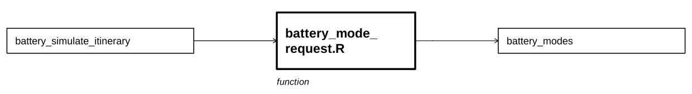

# battery_mode_request.R

**Function** &nbsp;·&nbsp; `30_Simulation/05_Models/03_Battery/03_Functions/battery_mode_request.R`

## Function

Gives the electricity that the mode of each row asks the battery to exchange with the system. A positive request asks the battery to charge, and a negative one to discharge. The request only depends on the mode and on the net electricity N of the rest of the system on the row (positive when the rest imports), not on the state of the battery: battery_trajectory() clips it with the limits of the battery. With the codes of battery_modes():

- 1, surplus_charge: max(-N, 0), the export of the rest.
- 2, charge: Inf, as much as the limits allow.
- 3, local_discharge: -max(N, 0), the import of the rest.
- 4, discharge: -Inf, as much as the limits allow.
- 5, stop: 0.

## Called by

- [battery_simulate_itinerary.R](battery_simulate_itinerary.md)

## What it calls, in order of appearance

- [battery_modes.R](battery_modes.md)

## Input data

- mode        : Integer vector. The mode of each row, from 1 to 5.
- rest_energy : Numeric vector, as long as mode. The net electricity of the rest of the system on each row (kWh, positive when the rest imports).

## Output data

- Numeric vector, as long as mode. The request of each row (kWh of the system side), which may be Inf or -Inf. The run stops if a mode is not one of the five.

## Other notes from the file header

### Code outline

1. Check the modes
2. Compute the request of each mode

### Usage instructions

```r
request <- battery_mode_request(
  mode        = c(1L, 4L),
  rest_energy = c(-0.2, 0.1)
  )
```

## Diagram



Also available as [battery_mode_request.svg](battery_mode_request.svg).

---

[Back to the code structure index](../Code_Structure.md)
