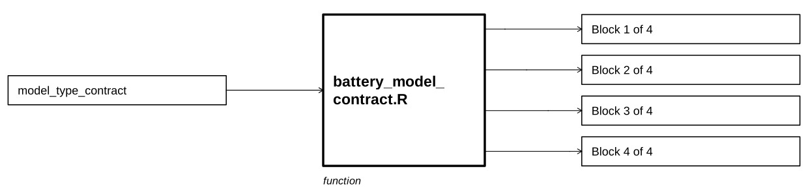

# battery_model_contract.R

**Function** &nbsp;·&nbsp; `30_Simulation/05_Models/03_Battery/03_Functions/battery_model_contract.R`

## Function

Gives the contract of the type of model Battery: the table of the functions through which the rest of the simulator operates a battery. It is the table that model_type_contract() returns for an asset whose asset_type is Battery. The operations, with their arguments and their results, are described in model_type_contract(). A battery charges from the system and discharges into it. Its operations are bound as follows:

- Those that carry out something are bound to functions of this folder, 30_Simulation/05_Models/03_Battery/03_Functions/: load_parameters, variable_registry, new_table, initial_state, plan_start_state, simulate_itinerary, execute_step, decode_genes, stored_energy_change, window_feasible, slot_offer, window_draft, margin_fit, window_contribution, hold_room, window_hold, continue_window_tail and tail_state. can_hold, recovery_choices, margin_energy and restate_systems are written below, in the table.
- prepare_year and prepare_period are written below, in the table: a battery has nothing to prepare on the year or on the period, and they return the table as it comes.

## Called by

- [model_type_contract.R](model_type_contract.md)

## What it calls, in order of appearance

- [load_battery_parameters.R](load_battery_parameters.md)
- [battery_variable_registry.R](battery_variable_registry.md)
- [battery_new_table.R](battery_new_table.md)
- [battery_initial_state.R](battery_initial_state.md)
- [battery_plan_start_state.R](battery_plan_start_state.md)
- [battery_simulate_itinerary.R](battery_simulate_itinerary.md)
- [battery_execute_step.R](battery_execute_step.md)
- [battery_stored_energy_change.R](battery_stored_energy_change.md)
- [battery_window_feasible.R](battery_window_feasible.md)
- [battery_slot_offer.R](battery_slot_offer.md)
- [battery_window_draft.R](battery_window_draft.md)
- [battery_margin_fit.R](battery_margin_fit.md)
- [battery_window_contribution.R](battery_window_contribution.md)
- [battery_hold_room.R](battery_hold_room.md)
- [battery_window_hold.R](battery_window_hold.md)
- [battery_continue_window_tail.R](battery_continue_window_tail.md)
- [battery_tail_state.R](battery_tail_state.md)
- [decode_battery_genes.R](decode_battery_genes.md)
- [battery_modes.R](battery_modes.md) &nbsp;(2 call sites)

## Blocks

The piece calls 19 items, so it is documented in blocks:

- [Called items, block 1 of 4](battery_model_contract__1.md)
- [Called items, block 2 of 4](battery_model_contract__2.md)
- [Called items, block 3 of 4](battery_model_contract__3.md)
- [Called items, block 4 of 4](battery_model_contract__4.md)

## Input data

- None.

## Output data

- Named list of functions, one per operation above.

## Other notes from the file header

### The operations

For a battery:

- load_parameters: its parameter group, battery, read from its file.
- variable_registry: the path of its variable registry, which declares the columns of its table.
- new_table: its table on the time grid, with the columns of its variable registry.
- prepare_year, prepare_period: it has nothing to prepare: they return the table as it comes.
- initial_state: the energy it stores at the start, written in row 1 of its table.
- plan_start_state: the plan starts from the energy the battery has actually stored.
- simulate_itinerary: what it stores, takes from the system and gives to it over a chunk, for one itinerary, in the mode of each row and within its limits.
- execute_step: the same over a step of the simulation.
- reads_rest_net: TRUE. The mode of the battery works over the net electricity of the rest of the system, so the battery is simulated after the other assets.
- gene_options: 5, the number of modes of battery_modes(). Each gene of a battery is the mode of one market interval.
- decode_genes: the genes become the control of the battery, the table with the start and the mode of each market interval.
- default_control: the stop mode, for the rows that no market has decided.
- comfort: 0 on every row, a battery changes no room.
- stored_energy_change: the change of the energy it stores on each row of an itinerary, on the side of the system, which the reward values.
- window_feasible: whether the flexibility windows of a leg respect the power and the energy limits of the battery.
- slot_offer: whether the battery has something to give, or to take, on the leg in a market interval.
- window_draft: its contribution to a flexibility window of the system in the Commitment Phase, before the commitment margin, and its margin data.
- margin_fit: its electricity inside the band of the commitment margin, when it is the only asset that contributes.
- margin_energy: the electricity of the margin data, which is the quantity the margin moves.
- window_contribution: its contribution to the window, with the Recovery Phase corrected so that the leg can be carried out until the close of the control horizon, or the refusal no_recovery.
- recovery_choices: the two ways it may draw the Recovery Phase of a window, minimum and plan, in the order they are tried.
- can_hold: TRUE, a battery can keep its electricity apart from its plan.
- hold_room: the electricity it can hold on each row of a window already sold.
- window_hold: holds what the system asks of it in a window already sold, within its limits, and carries its leg out until the close of the control horizon.
- restate_systems: NULL, it has no alternatives to redraw a window already sold with.
- continue_window_tail: continues the Neutral and Recovery Phases of a window whose Commitment Phase ended before the chunk, from the energy the window left, and carries its leg out until the close of the control horizon.
- tail_state: the energy the leg stores at the start of the horizon. A battery has no system to give.

### Auxiliary functions

The operations that are a line are written as auxiliary functions of battery_model_contract(), in this file, after it. They are named functions, defined once when the file is sourced, so that the contract hands over the same functions on every call instead of creating them again. The file holds:

- battery_model_contract() (main function)
- battery_recovery_choices()
- battery_can_hold()
- battery_margin_energy()
- battery_comfort()
- battery_reads_rest_net()
- battery_prepare_year()
- battery_prepare_period()
- battery_gene_options()
- battery_default_control()
- battery_restate_systems()

### Code outline

1. Bind each operation to its function

### Usage instructions

```r
contract <- battery_model_contract()
```

```r
battery_df <- contract$new_table(
  time  = Main_df$time,
  paths = paths
  )
```

## Diagram



Also available as [battery_model_contract.svg](battery_model_contract.svg).

---

[Back to the code structure index](../Code_Structure.md)
