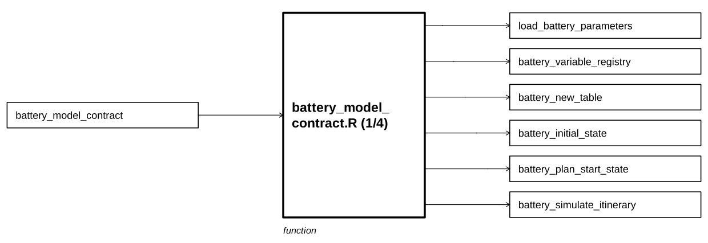

# battery_model_contract.R &mdash; Called items, block 1 of 4

Block 1 of 4 of [battery_model_contract.R](battery_model_contract.md).

## What it calls, in this block

- [load_battery_parameters.R](load_battery_parameters.md)
- [battery_variable_registry.R](battery_variable_registry.md)
- [battery_new_table.R](battery_new_table.md)
- [battery_initial_state.R](battery_initial_state.md)
- [battery_plan_start_state.R](battery_plan_start_state.md)
- [battery_simulate_itinerary.R](battery_simulate_itinerary.md)

## Diagram

Also available as [battery_model_contract__1.svg](battery_model_contract__1.svg).

---

[Back to battery_model_contract.R](battery_model_contract.md) &nbsp;·&nbsp; [Back to the code structure index](../Code_Structure.md)
