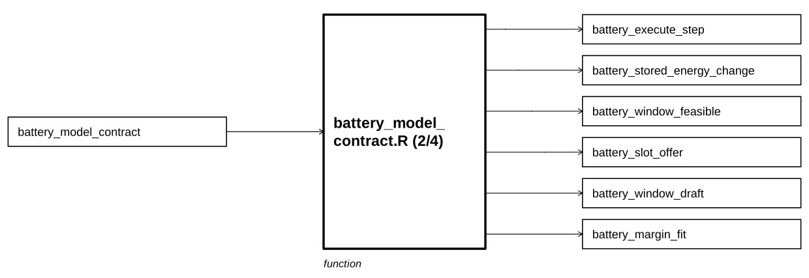

# battery_model_contract.R &mdash; Called items, block 2 of 4

Block 2 of 4 of [battery_model_contract.R](battery_model_contract.md).

## What it calls, in this block

- [battery_execute_step.R](battery_execute_step.md)
- [battery_stored_energy_change.R](battery_stored_energy_change.md)
- [battery_window_feasible.R](battery_window_feasible.md)
- [battery_slot_offer.R](battery_slot_offer.md)
- [battery_window_draft.R](battery_window_draft.md)
- [battery_margin_fit.R](battery_margin_fit.md)

## Diagram

Also available as [battery_model_contract__2.svg](battery_model_contract__2.svg).

---

[Back to battery_model_contract.R](battery_model_contract.md) &nbsp;·&nbsp; [Back to the code structure index](../Code_Structure.md)
