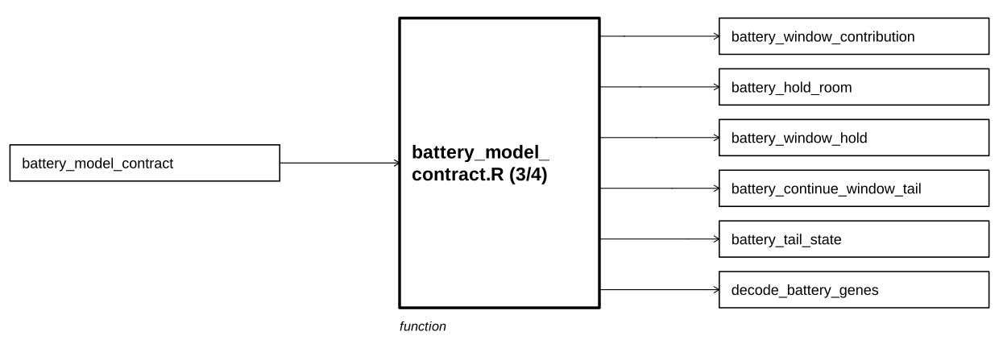

# battery_model_contract.R &mdash; Called items, block 3 of 4

Block 3 of 4 of [battery_model_contract.R](battery_model_contract.md).

## What it calls, in this block

- [battery_window_contribution.R](battery_window_contribution.md)
- [battery_hold_room.R](battery_hold_room.md)
- [battery_window_hold.R](battery_window_hold.md)
- [battery_continue_window_tail.R](battery_continue_window_tail.md)
- [battery_tail_state.R](battery_tail_state.md)
- [decode_battery_genes.R](decode_battery_genes.md)

## Diagram

Also available as [battery_model_contract__3.svg](battery_model_contract__3.svg).

---

[Back to battery_model_contract.R](battery_model_contract.md) &nbsp;·&nbsp; [Back to the code structure index](../Code_Structure.md)
